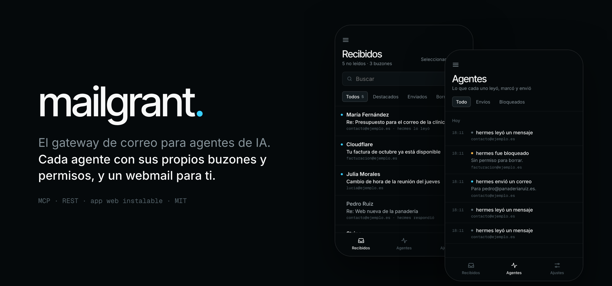
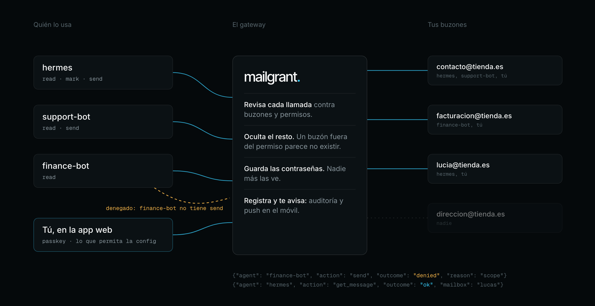
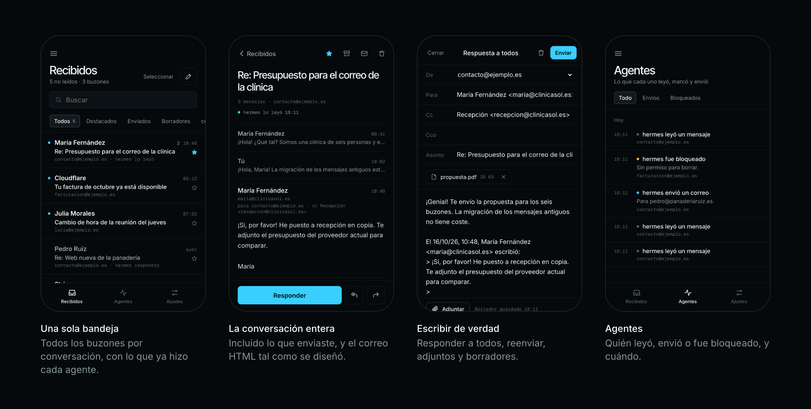
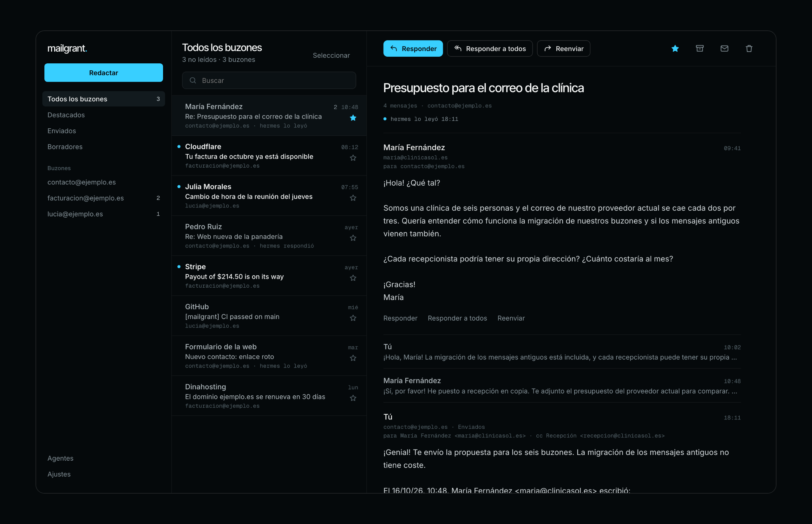

<p align="center"></p>

<h1 align="center">mailgrant</h1>

<p align="center"><b>El gateway de correo autoalojado para agentes de IA.</b><br>
Un servidor MCP y una API REST para correo electrónico, delante de tus buzones IMAP/SMTP: cada agente recibe su propio token, sus propios buzones y sus propios permisos, y tú tienes un webmail para seguir todo de cerca.</p>

<p align="center">
  <a href="https://github.com/lucasmaffei/mailgrant/actions/workflows/ci.yml"></a>
  
  
  
  <a href="LICENSE"></a>
</p>

<p align="center"><a href="README.md">English</a> · <a href="README.pt-BR.md">Português</a> · <b>Español</b> · <a href="README.fr.md">Français</a> · <a href="README.zh-CN.md">简体中文</a></p>

<p align="center"></p>

Claude, Codex, OpenClaw, Hermes, tus propios scripts: todo agente que toca el
correo termina guardando una copia de la contraseña de cada buzón, en su propio
servidor, en su propia configuración. mailgrant pone en su lugar un único
gateway de correo (una pasarela entre los agentes y los buzones) delante de
todos ellos. Registras cada buzón **una sola vez** y luego decides quién puede
usar qué buzones y con qué acciones:

- **Los agentes** reciben un bearer token y hablan [MCP](https://modelcontextprotocol.io) (Streamable HTTP) o REST puro.
- **Tú** tienes, si quieres, un webmail en el celular y en la computadora, con inicio de sesión por clave de acceso (passkey), notificaciones push y una línea de tiempo con todo lo que hizo cada agente.

Cada llamada, venga de donde venga, pasa por los mismos permisos y el mismo registro de auditoría.

<p align="center"></p>

## Contenido

[En la práctica](#en-la-práctica) · [Funcionalidades](#funcionalidades) · [Inicio rápido](#inicio-rápido) · [Conecta un agente](#conecta-un-agente) · [La app web](#la-app-web) · [Configuración](#configuración) · [API REST](#api-rest) · [Seguridad](#seguridad) · [Preguntas frecuentes](#preguntas-frecuentes)

## En la práctica

Con el agente conectado, solo tienes que pedir. El agente ve únicamente las
herramientas y los buzones que su token permite.

> **Tú:** ¿Qué llegó hoy a contact@ que todavía necesita respuesta?
>
> **El agente** llama a `inbox(mailbox="contact", unseen=true, since="16-Oct-2026")` y luego a `get_message` en cada uno:
>
> 3 sin leer. Mariana (clínica, 6 personas) pide un presupuesto para migrar sus buzones.
> Pedro aprobó la versión 2 del sitio de la panadería. Una notificación del formulario dice que
> el enlace de la campaña de octubre abre la página equivocada. ¿Le respondo a Mariana?

> **Tú:** Sí, respóndele en el mismo hilo con nuestros precios y marca los otros dos como leídos.
>
> **El agente** llama a `send(mailbox="contact", to=["mariana@…"], in_reply_to="<…>", …)` y dos veces a `mark_seen`.
> La respuesta queda en la carpeta Enviados del buzón, dentro del hilo, donde tu equipo (y la app web) la puede ver.

> **Un agente de finanzas de solo lectura** intenta `send(mailbox="billing", …)` y recibe
> `403 scope`. Nunca vio una herramienta `send`, y el intento aparece como
> **denegado** en tu registro de auditoría y en la app.

Para qué se usa:

| Caso | Buzones | Scopes |
|---|---|---|
| **Atención al cliente.** Un agente responde la dirección de contacto dentro del hilo original, y la respuesta queda en Enviados para que el equipo la vea. | `contact@` | `read`, `mark`, `send` |
| **Finanzas.** Un agente lee facturas y comprobantes para conciliar pagos. No puede responder ni borrar nada. | `billing@` | `read` |
| **Resumen diario.** Un script programado resume cada mañana lo que llegó sin leer a todos los buzones. | `*` | `read` |
| **Asistente personal.** Ordena tu propia bandeja: marca lo que ya viste, manda los newsletters a la papelera, responde lo rutinario. | `you@` | `read`, `mark`, `delete`, `send` |
| **Agencia con muchos clientes.** El agente de cada cliente llega solo a los buzones de ese cliente, aunque estén en el mismo servidor. | `client-a@`, `billing@client-a` | `read`, `send` |
| **Captación de leads.** Un agente de ventas lee las notificaciones del formulario del sitio y responde a los leads nuevos desde `sales@`, y no ve nada más. | `sales@` | `read`, `send` |

Cambiar la contraseña de un buzón, cortarle el acceso a un agente o agregar un
buzón es un cambio en el gateway. No hay que tocar ningún agente.

## Funcionalidades

- **Permisos por agente**: buzones por nombre, dirección o `*` (incluidos los que se agreguen después); scopes `read`, `mark`, `delete`, `send`.
- **Invisible fuera del permiso**: un buzón que el agente no puede usar responde exactamente igual que uno que no existe.
- **Lista de herramientas acotada**: el `tools/list` de MCP muestra solo las herramientas que el token puede llamar.
- **Bandeja unificada**: una sola llamada busca en paralelo en todos los buzones permitidos.
- **Borrado seguro**: mueve a la papelera; eliminar de verdad exige `permanent=true` y afecta a un solo mensaje.
- **Respuestas en el hilo** con `in_reply_to`, y una copia de cada mensaje enviado en la carpeta Enviados.
- **Sin suplantación**: `from_address` limitado a la dirección del propio buzón y a los alias declarados.
- **Registro de auditoría**: solo metadatos, nunca asuntos ni cuerpos.
- **Modo lectura** para agentes: el correo HTML vuelve como texto limpio.
- **Webmail opcional**: PWA instalable con passkeys, push, conversaciones, borradores, correo HTML en un sandbox y la actividad de los agentes. En English, Português, Español, Français y 简体中文.
- **Administración desde la app (opcional)**: agrega buzones, crea agentes, cambia sus permisos y rota tokens en vivo, sin reiniciar.
- **Sin estado cuando no usas la app web**: sin base de datos; las conexiones se abren en cada request y se cierran.
- **Secretos desde el entorno**: `${VAR}` en cualquier parte, o toda la configuración en `MAILGRANT_CONFIG_B64`.

## Inicio rápido

Necesitas Docker y los datos IMAP/SMTP de al menos un buzón (lo ideal es una
contraseña de aplicación). Cinco minutos:

```bash
git clone https://github.com/lucasmaffei/mailgrant && cd mailgrant
cp config.example.yaml config.yaml

# 1. Genera un token por agente. El token es para el agente; tú te quedas con el hash.
docker run --rm ghcr.io/lucasmaffei/mailgrant:latest mailgrant token --name support-bot

# 2. Edita config.yaml: tus buzones, los agentes con sus hashes
#    y la sección `web:` si quieres la app (ver más abajo).

# 3. Valídalo. Muestra quién puede tocar qué.
docker run --rm -v "$PWD/config.yaml:/etc/mailgrant/config.yaml:ro" \
  ghcr.io/lucasmaffei/mailgrant:latest mailgrant check

# 4. Levántalo (publicado en loopback; pon TLS delante antes de exponerlo).
docker compose up -d
curl -s http://127.0.0.1:8000/health
curl -s -H "Authorization: Bearer $TOKEN" http://127.0.0.1:8000/whoami

# 5. Solo para la app web: un enlace de un solo uso para crear tu passkey
#    (o define MAILGRANT_SETUP_CODE y escríbelo en la pantalla de inicio de sesión).
docker compose exec mailgrant mailgrant invite
```

El `config.yaml` útil más pequeño:

```yaml
agents:
  - name: support-bot
    token_sha256: "9f86d08…"          # lo imprime `mailgrant token`
    mailboxes: [contact]
    scopes: [read, mark, send]

mailboxes:
  - name: contact
    imap: {host: mail.example.com, username: contact@example.com, password: "${CONTACT_PASSWORD}"}
    smtp: {host: mail.example.com, username: contact@example.com, password: "${CONTACT_PASSWORD}",
           from_address: "Example <contact@example.com>", save_copy_to: Sent}
```

¿Vas a desplegar en un PaaS? Hay una guía paso a paso para
**[Coolify](docs/deploy-coolify.md) (en inglés)**; las mismas variables de entorno
funcionan en cualquier host con Docker. ¿Sin acceso al registry? `docker compose up -d --build`
construye la imagen desde el código clonado.

## Conecta un agente

Sirve cualquier cliente MCP que soporte Streamable HTTP con un header bearer.
Guía completa, incluidos Cursor y Claude Desktop: **[docs/connect-agents.md](docs/connect-agents.md) (en inglés)**.

```bash
# Claude Code
claude mcp add --transport http mailgrant https://mail-mcp.example.com/mcp \
  --header "Authorization: Bearer $MAILGRANT_TOKEN"

# Codex
codex mcp add mailgrant --url https://mail-mcp.example.com/mcp \
  --bearer-token-env-var MAILGRANT_TOKEN

# Cualquier cliente que solo lance servidores stdio (OpenClaw, clientes más antiguos)
npx -y mcp-remote@0.1.38 https://mail-mcp.example.com/mcp \
  --transport http-only --header "Authorization: Bearer $MAILGRANT_TOKEN"
```

Dales a tus agentes la skill de [`.agents/skills/mailgrant/SKILL.md`](.agents/skills/mailgrant/SKILL.md) (en inglés):
les enseña a consultar `whoami` primero, responder dentro del hilo y confirmar antes de borrar.

### Deja que el agente se configure solo

Genera el token del agente, ponlo en la variable de entorno `MAILGRANT_TOKEN`
donde corre el agente y pega este prompt en una conversación con él (cambia
la URL por la tuya):

```text
Conéctate a mi gateway de correo mailgrant.

- Endpoint MCP: https://mail-mcp.example.com/mcp
- Tu token está en la variable de entorno MAILGRANT_TOKEN. Nunca lo imprimas,
  nunca lo escribas en texto plano en un archivo y nunca lo envíes a ningún
  lugar que no sea el header Authorization de ese endpoint.

Pasos:
1. Averigua en qué harness de agente estás corriendo y agrega un servidor MCP
   remoto llamado "mailgrant" con la URL de arriba y el header
   "Authorization: Bearer <token>":
   - Claude Code: claude mcp add --scope user --transport http mailgrant <url> --header "Authorization: Bearer $MAILGRANT_TOKEN"
   - Codex: codex mcp add mailgrant --url <url> --bearer-token-env-var MAILGRANT_TOKEN
   - Cualquier otro: regístralo en tu configuración MCP como servidor Streamable HTTP
     con ese header. Si solo puedes lanzar servidores stdio, usa
     npx -y mcp-remote@0.1.38 <url> --transport http-only --header "Authorization:${AUTH_HEADER}"
     con AUTH_HEADER="Bearer <token>" en el entorno del proceso.
2. Instala la skill de uso desde
   https://github.com/lucasmaffei/mailgrant/tree/main/.agents/skills/mailgrant
   (Claude Code: ~/.claude/skills/mailgrant/SKILL.md). Si no puedes instalar
   skills, lee el archivo y sigue sus reglas.
3. Recarga tus servidores MCP si tu harness lo necesita y luego llama a la herramienta whoami.
4. Dime qué agente eres, tus scopes, los buzones que puedes usar y cuántos
   mensajes sin leer tiene cada uno (inbox con unseen=true). No marques nada
   como leído, no borres nada y no envíes nada.
```

Si el agente responde con su propio nombre, sus scopes y los buzones correctos,
está listo. Un `401` significa que el token no coincide con ningún hash de la configuración.

### Herramientas MCP

| Scope | Herramientas |
|---|---|
| — | `whoami` |
| `read` | `mailboxes`, `inbox`, `list_folders`, `list_messages`, `search`, `get_message` |
| `mark` | `mark_seen` |
| `delete` | `delete_message` |
| `send` | `send` |

Leer nunca modifica un mensaje: las carpetas se abren en solo lectura (`EXAMINE`),
así que la marca de leído queda como la dejaron las personas.

## La app web

<p align="center"></p>

Un webmail autoalojado para la persona dueña de los buzones, integrado en el mismo servidor.
Viene **desactivado por defecto**; agrega una sección `web:` para activarlo:

```yaml
web:
  origin: https://mail.example.com     # donde lo abres
  data_dir: /data                       # SQLite para passkeys, dispositivos push e historial
  user: {name: you, mailboxes: ["*"], scopes: [read, mark, delete, send]}
```

Crea tu primera passkey con `mailgrant invite` (un enlace de un solo uso para abrir en
el celular) o definiendo `MAILGRANT_SETUP_CODE` y escribiéndolo en la pantalla de
inicio de sesión. Después agrega la app a la pantalla de inicio y activa las notificaciones.

- **Un cliente de correo de verdad**: una bandeja para todos los buzones, conversaciones, responder a todos,
  reenviar, Cc/Cco, adjuntos, borradores guardados en la carpeta Borradores del buzón,
  firmas, estrellas, archivo, una vista de Enviados que dice quién envió qué, acciones
  en lote y gestos de deslizar en el celular.
- **Correo HTML tal como fue diseñado**, sanitizado y mostrado en un frame aislado (sandbox); las imágenes
  remotas esperan hasta que las permitas, por mensaje o por remitente.
- **Línea de tiempo de los agentes**: qué leyó, envió o tuvo denegado cada agente, y cuándo, con
  una notificación push cuando un agente envía un correo.
- **Administra todo desde ahí** (`manage: true`): buzones, agentes, scopes y
  tokens, en vivo, con la passkey solicitada de nuevo en cada cambio.
- **Cinco idiomas**: English, Português, Español, Français y 简体中文,
  tomado del dispositivo o elegido en los ajustes de la app.
- La persona recibe permisos igual que un agente, así que un celular de solo lectura es una línea.
  Quita la sección y `/app` desaparece; los agentes no se ven afectados.

<p align="center"></p>

Guía completa: **[docs/web-app.md](docs/web-app.md) (en inglés)** (instalación en iPhone,
notificaciones, qué se guarda, modelo de seguridad, cómo desactivarla).

## Configuración

```yaml
agents:
  - name: support-bot
    token_sha256: "9f86d08…"          # de `mailgrant token`; o token: "${SUPPORT_TOKEN}"
    mailboxes: [contact]              # nombres, direcciones o "*"
    scopes: [read, mark, send]

mailboxes:
  - name: contact
    imap:
      host: mail.example.com          # puerto 993, tls ssl por defecto
      username: contact@example.com
      password: "${CONTACT_PASSWORD}"
    smtp:
      host: mail.example.com
      port: 465
      tls: ssl
      username: contact@example.com
      password: "${CONTACT_PASSWORD}"
      from_address: "Example <contact@example.com>"
      allowed_from: [sales@example.com]
      save_copy_to: Sent

web:                                  # opcional, ver "La app web"
  origin: https://mail.example.com
  data_dir: /data
  user: {name: owner, mailboxes: ["*"], scopes: [read, mark, delete, send]}
```

[`config.example.yaml`](config.example.yaml) documenta todas las opciones.

### Reglas que conviene conocer

- Los permisos se verifican al arrancar: un error de tipeo en los `mailboxes` de un agente detiene el servidor en lugar de no conceder nada en silencio.
- El mismo token (o hash) en dos agentes es un error.
- `token_sha256` mantiene el archivo libre de secretos utilizables; `token: "${VAR}"` lo deja en el entorno. Las dos opciones funcionan.
- `auth.tokens` (de docker-mailbox) sigue funcionando y le da acceso total a cualquiera que lo tenga. `mailgrant check` avisa al respecto.
- Cambiar el archivo de configuración requiere reiniciar. Con `web.manage: true`, los buzones y agentes viven en la app y cambian sin reiniciar.

### Opciones de buzón

| Clave | Por defecto | Notas |
|---|---|---|
| `imap.port` / `imap.tls` | `993` / `ssl` | `tls`: `ssl`, `starttls`, `none` |
| `imap.default_folder` | `INBOX` | |
| `imap.trash_folder` | auto | Carpeta marcada como `\Trash`, luego `Trash`, `Deleted Items`, `Lixeira` |
| `smtp.port` / `smtp.tls` | `587` / `starttls` | |
| `smtp.from_address` | — | Obligatorio. `From:` por defecto |
| `smtp.allowed_from` | `[]` | Otras direcciones `From:` que pueden usar quienes llaman |
| `smtp.save_copy_to` | — | Carpeta IMAP que recibe una copia de cada mensaje enviado (requiere `imap`) |

### Opciones de la app web

| Clave | Por defecto | Notas |
|---|---|---|
| `web.enabled` | `true` | `false` conserva la sección pero desactiva la app |
| `web.origin` | — | Obligatorio. `https://host` (o `http://localhost` para pruebas) |
| `web.data_dir` | `/data` | SQLite; debe persistir entre reinicios |
| `web.user` | `owner`, `*`, todos los scopes | Recibe permisos igual que un agente |
| `web.poll_seconds` | `60` | Cada cuánto se busca correo nuevo para el push |
| `web.session_days` | `30` | Duración de la sesión en un dispositivo |
| `web.push_contact` | origin | Contacto `mailto:` o `https:` para los servicios de push |
| `web.manage` | `false` | Administra buzones y agentes en la app; requiere `MAILGRANT_SECRET_KEY`. Ver [docs/web-app.md](docs/web-app.md#manage-mailboxes-and-agents-in-the-app-optional) (en inglés) |
| `web.setup_code` | `MAILGRANT_SETUP_CODE` | Código que se escribe en la pantalla de inicio de sesión para crear la primera passkey; deja de valer en cuanto existe una |

## API REST

Todas las rutas excepto `/health` requieren `Authorization: Bearer <token>`.

| Método | Ruta | Scope | Qué hace |
|---|---|---|---|
| `GET` | `/health` | — | Liveness, siempre abierta |
| `GET` | `/whoami` | — | Agente, scopes y buzones de este token |
| `GET` | `/mailboxes` | read | Buzones permitidos |
| `GET` | `/inbox` | read | Búsqueda unificada en los buzones permitidos |
| `GET` | `/mailboxes/{name}/folders` | read | Carpetas IMAP |
| `GET` | `/mailboxes/{name}/messages?folder=&limit=&search=` | read | Encabezados, del más nuevo al más viejo (búsqueda IMAP cruda) |
| `GET` | `/mailboxes/{name}/search?from=&subject=&…` | read | Búsqueda estructurada en un buzón |
| `GET` | `/mailboxes/{name}/messages/{uid}?folder=&reader=` | read | Mensaje completo; `reader=true` agrega `body_reader` |
| `POST` | `/mailboxes/{name}/messages/{uid}/seen` | mark | Cuerpo `{"seen": true\|false}` |
| `DELETE` | `/mailboxes/{name}/messages/{uid}?folder=&permanent=` | delete | Mueve a la papelera o elimina |
| `POST` | `/mailboxes/{name}/send` | send | Envía (ver abajo) |

`{name}` también acepta la dirección del buzón. `/inbox` y `/search` aceptan `from`,
`to`, `subject`, `body`, `text`, `since`, `before` (fechas IMAP como
`14-Oct-2026`), `unseen`, `seen`, `flagged`, `answered`, `larger_than`,
`smaller_than`, `folder` y `limit` (≤ 500); `/inbox` también acepta `mailbox`
(CSV de nombres o direcciones). El esquema OpenAPI está en `/openapi.json` (requiere token).

```bash
# Correo sin leer en todos los buzones que este token puede leer
curl -s -H "Authorization: Bearer $TOKEN" "http://127.0.0.1:8000/inbox?unseen=true&limit=20"

# Responder dentro de un hilo
curl -s -X POST -H "Authorization: Bearer $TOKEN" -H "Content-Type: application/json" \
  http://127.0.0.1:8000/mailboxes/contact/send -d '{
    "to": ["client@example.com"], "subject": "Re: Order 42",
    "body_text": "It ships tomorrow.", "in_reply_to": "<original-message-id@example.com>"
  }'
```

Cuerpo del envío:

```json
{
  "to": ["client@example.com"], "cc": [], "bcc": [],
  "subject": "Re: Order 42",
  "body_text": "…", "body_html": null,
  "in_reply_to": "<original-message-id@example.com>",
  "references": null, "reply_to": null, "from_address": null
}
```

Los errores son JSON `{"detail": "…"}`: `401` token inválido o ausente · `403` falta el scope
o `from_address` no permitido · `404` buzón desconocido **o no
permitido** · `409` el buzón no tiene IMAP/SMTP · `502` el servidor de correo rechazó la operación.

## Registro de auditoría

Con `audit_log: true` (por defecto), cada operación de correo escribe una línea en el
logger `mailgrant.audit` por stdout:

```json
{"ts": "2026-10-14T22:01:08+00:00", "agent": "support-bot", "action": "get_message", "outcome": "ok", "mailbox": "contact", "uid": "42"}
{"ts": "2026-10-14T22:01:09+00:00", "agent": "support-bot", "action": "delete_message", "outcome": "denied", "reason": "scope", "mailbox": "contact"}
{"ts": "2026-10-14T22:01:10+00:00", "agent": "support-bot", "action": "send", "outcome": "ok", "mailbox": "contact", "to": ["client@example.com"], "message_id": "<…>"}
```

Los asuntos y los cuerpos nunca se registran.

## Seguridad

- **Úsalo detrás de TLS.** Por él pasan tokens y correos. Compose escucha en `127.0.0.1` por defecto; exponlo solo a través de un proxy inverso HTTPS.
- **La configuración contiene las contraseñas de los buzones.** Prefiere referencias `${VAR}` o `MAILGRANT_CONFIG_B64` desde el gestor de secretos de tu plataforma; nunca hagas commit de un `config.yaml` completo.
- **Los tokens se comparan en tiempo constante**, y en cada request se comparan todos los candidatos.
- **La inyección de comandos IMAP** se bloquea en el borde: se rechazan caracteres de control en los nombres de carpeta, los nombres de carpeta van entre comillas y los UID son solo dígitos.
- **Borrar nunca elimina por sorpresa**: primero la papelera, `UID EXPUNGE` para exactamente un mensaje, y rechazo en servidores sin UIDPLUS.
- **La app web** inicia sesión solo con passkeys, guarda las sesiones en cookies `HttpOnly`/`SameSite=Strict`, verifica `Origin` en cada cambio, sirve un CSP que no carga nada de otros orígenes y muestra el correo HTML sanitizado en un frame aislado donde ningún script puede ejecutarse. Detalles en [docs/web-app.md](docs/web-app.md#security-model) (en inglés).
- **Un token es tan restringido como su permiso.** Dale a cada agente la menor cantidad de buzones y scopes que necesite; reserva `"*"` para agentes a los que les confiarías todos.

¿Encontraste una vulnerabilidad? Sigue [SECURITY.md](SECURITY.md) (en inglés) en lugar de abrir un issue público.

## Preguntas frecuentes

**¿Funciona con Gmail, Outlook, Fastmail, iCloud, Zoho, Mailcow…?**
Con cualquier cosa que hable IMAP y SMTP. Para Gmail, iCloud y Yahoo usa una
contraseña de aplicación; para servidores autoalojados (Mailcow, Mailu, Dovecot/Postfix)
lo ideal es una contraseña de aplicación dedicada para cada gateway.

**¿Es un servidor de correo?** No. Nunca recibe correo de internet; inicia
sesión en tus buzones existentes como lo haría un cliente de correo.

**¿Mis correos pasan por un tercero?** No. Tú lo operas; el correo va de
tu servidor de correo a tu gateway y de ahí a tu agente. Sin la app web no se
guarda nada; con ella, las passkeys, las suscripciones push y un historial de actividad
sin asuntos ni cuerpos (y, con `manage: true`, los buzones y agentes, con las
contraseñas cifradas).

**¿Qué agentes pueden usarlo?** Cualquier cliente MCP con Streamable HTTP (Claude Code,
Codex, Cursor, Claude Desktop vía `mcp-remote`, OpenClaw, Hermes…) y cualquier cosa
que pueda hacer una petición HTTP.

**¿Un agente puede leerlo todo?** Solo lo que dice su permiso. Un buzón fuera
del permiso parece no existir, y las herramientas fuera de sus scopes no
aparecen.

## Ejecutar desde el código fuente

```bash
uv sync --all-groups
uv run mailgrant check --config config.yaml
uv run mailgrant http --config config.yaml   # escucha en 127.0.0.1:8000
uv run pytest -q
```

Las ilustraciones y capturas del README se generan desde [`docs/assets/src`](docs/assets/src).
Las contribuciones son bienvenidas, incluidos nuevos idiomas para la app web: consulta
[CONTRIBUTING.md](CONTRIBUTING.md) (en inglés).

## Créditos

mailgrant es un fork de [docker-mailbox](https://github.com/psyb0t/docker-mailbox)
de Ciprian Mandache (psyb0t), que aporta la capa IMAP/SMTP, la bandeja
unificada, el modo lectura y el transporte MCP. mailgrant agrega permisos por agente,
auditoría, borrado seguro, envío en hilo y la app web.

## Licencia

MIT, ver [LICENSE](LICENSE). La imagen Docker incluye componentes de terceros
bajo sus propias licencias (html2text es GPL-3.0; las fuentes de la app web son OFL);
ver [THIRD_PARTY.md](THIRD_PARTY.md).
