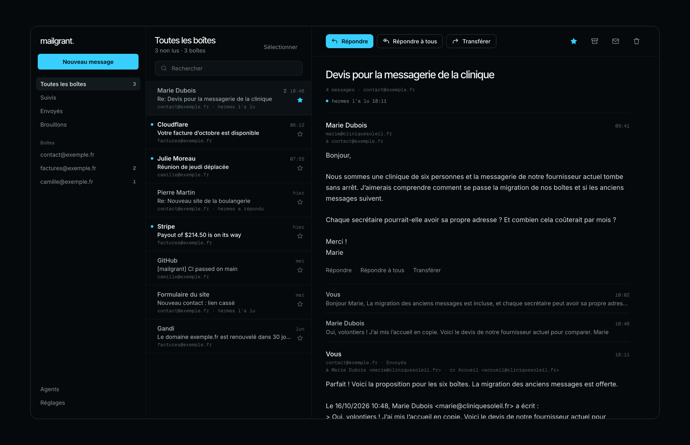

<p align="center"></p>

<h1 align="center">mailgrant</h1>

<p align="center"><b>La passerelle e-mail auto-hébergée pour les agents IA.</b><br>
Un seul point d’accès, serveur MCP et API REST, devant vos boîtes mail IMAP/SMTP : chaque agent reçoit son propre jeton, ses propres boîtes et ses propres permissions, et vous avez un webmail pour suivre ce qui se passe.</p>

<p align="center">
  <a href="https://github.com/lucasmaffei/mailgrant/actions/workflows/ci.yml"></a>
  
  
  
  <a href="LICENSE"></a>
</p>

<p align="center"><a href="README.md">English</a> · <a href="README.pt-BR.md">Português</a> · <a href="README.es.md">Español</a> · <b>Français</b> · <a href="README.zh-CN.md">简体中文</a></p>

<p align="center"></p>

Claude, Codex, OpenClaw, Hermes, vos propres scripts : chaque agent qui touche
aux e-mails finit par détenir une copie de chaque mot de passe de boîte mail, sur
son propre serveur, dans sa propre config. mailgrant place à la place une seule
passerelle IMAP/SMTP devant les boîtes. Vous enregistrez chaque boîte **une
seule fois**, puis vous décidez qui peut utiliser quelles boîtes et quelles actions :

- **Les agents IA** reçoivent un jeton d’accès (bearer token) et parlent [MCP](https://modelcontextprotocol.io) (Streamable HTTP) ou REST tout simplement.
- **Vous** disposez d’un webmail facultatif sur votre téléphone et votre ordinateur, avec connexion par clé d’accès (passkey), notifications push et un historique de tout ce que chaque agent a fait.

Chaque appel, d’un côté comme de l’autre, passe par les mêmes autorisations et le même journal d’audit.

<p align="center"></p>

## Sommaire

[En pratique](#en-pratique) · [Fonctionnalités](#fonctionnalités) · [Démarrage rapide](#démarrage-rapide) · [Connecter un agent](#connecter-un-agent) · [Application web](#application-web) · [Configuration](#configuration) · [API REST](#api-rest) · [Sécurité](#sécurité) · [FAQ](#faq)

## En pratique

Une fois l’agent connecté, il suffit de lui demander. L’agent ne voit que les
outils et les boîtes mail que son jeton autorise.

> **Vous :** Qu’est-ce qui est arrivé aujourd’hui sur contact@ et attend encore une réponse ?
>
> **L’agent** appelle `inbox(mailbox="contact", unseen=true, since="16-Oct-2026")`, puis `get_message` sur chacun :
>
> 3 non lus. Mariana (cabinet médical, 6 personnes) veut un devis pour migrer ses boîtes mail.
> Pedro a validé la version 2 du site de la boulangerie. Une notification de formulaire signale que
> le lien de la campagne d’octobre ouvre la mauvaise page. Je réponds à Mariana ?

> **Vous :** Oui, réponds dans le même fil avec nos tarifs, et marque les deux autres comme lus.
>
> **L’agent** appelle `send(mailbox="contact", to=["mariana@…"], in_reply_to="<…>", …)` puis deux fois `mark_seen`.
> La réponse arrive dans le dossier Envoyés de la boîte, dans le fil, là où votre équipe (et l’application web) peut la voir.

> **Un agent comptable en lecture seule** tente `send(mailbox="billing", …)` et reçoit
> `403 scope`. Il n’a même jamais vu d’outil `send`, et la tentative
> apparaît comme **refusée** dans votre journal d’audit et dans l’application.

Ce qu’on en fait :

| Cas | Boîtes mail | Scopes |
|---|---|---|
| **Support client.** Un agent répond à l’adresse de contact dans le fil d’origine, et la réponse arrive dans Envoyés, visible par l’équipe. | `contact@` | `read`, `mark`, `send` |
| **Comptabilité.** Un agent lit les factures et les reçus pour rapprocher les paiements. Il ne peut ni répondre ni supprimer quoi que ce soit. | `billing@` | `read` |
| **Résumé quotidien.** Un script planifié résume chaque matin ce qui est arrivé non lu dans toutes les boîtes. | `*` | `read` |
| **Assistant personnel.** Trie votre propre boîte de réception : marque ce que vous avez vu, met les newsletters à la corbeille, répond aux messages de routine. | `you@` | `read`, `mark`, `delete`, `send` |
| **Agence avec de nombreux clients.** L’agent de chaque client n’accède qu’aux boîtes de ce client, même sur le même serveur. | `client-a@`, `billing@client-a` | `read`, `send` |
| **Réception des prospects.** Un agent commercial lit les notifications du formulaire du site et répond aux nouveaux prospects depuis `sales@`, sans rien voir d’autre. | `sales@` | `read`, `send` |

Changer le mot de passe d’une boîte, couper l’accès d’un agent ou ajouter une boîte,
c’est une modification de la passerelle. Aucun agent n’a besoin d’être touché.

## Fonctionnalités

- **Autorisations par agent** : boîtes mail par nom, par adresse ou `*` (y compris les futures) ; scopes `read`, `mark`, `delete`, `send`.
- **Invisible hors autorisation** : une boîte qu’un agent ne peut pas utiliser répond exactement comme une boîte qui n’existe pas.
- **Liste d’outils filtrée** : le `tools/list` MCP n’affiche que les outils qu’un jeton peut appeler.
- **Boîte de réception unifiée** : un seul appel cherche dans toutes les boîtes autorisées, en parallèle.
- **Suppression sûre** : déplace vers la corbeille ; effacer exige `permanent=true` et ne touche qu’un seul message.
- **Réponses dans le fil** avec `in_reply_to`, et une copie de chaque message envoyé dans le dossier Envoyés.
- **Pas d’usurpation** : `from_address` limité à l’adresse propre de la boîte et aux alias déclarés.
- **Journal d’audit** : uniquement des métadonnées, jamais les objets ni le contenu des messages.
- **Mode lecture** pour les agents : les e-mails HTML reviennent en texte propre.
- **Webmail facultatif** : PWA installable avec clés d’accès, push, conversations, brouillons, e-mails HTML dans un bac à sable et l’activité des agents. Interface en English, Português, Español, Français et 简体中文.
- **Gestion depuis l’application (facultatif)** : ajoutez des boîtes, créez des agents, modifiez leurs permissions et renouvelez leurs jetons à chaud, sans redémarrage.
- **Sans état sans l’application web** : aucune base de données ; les connexions s’ouvrent à chaque requête puis se ferment.
- **Secrets depuis l’environnement** : `${VAR}` n’importe où, ou toute la config dans `MAILGRANT_CONFIG_B64`.

## Démarrage rapide

Il vous faut Docker et les paramètres IMAP/SMTP d’au moins une boîte mail (un mot
de passe d’application, c’est l’idéal). Cinq minutes :

```bash
git clone https://github.com/lucasmaffei/mailgrant && cd mailgrant
cp config.example.yaml config.yaml

# 1. Générez un jeton par agent. Donnez le jeton à l'agent ; gardez le hash.
docker run --rm ghcr.io/lucasmaffei/mailgrant:latest mailgrant token --name support-bot

# 2. Modifiez config.yaml : vos boîtes mail, les agents avec leurs hashs,
#    et la section `web:` si vous voulez l'application (voir plus bas).

# 3. Validez-le. La commande affiche qui peut toucher à quoi.
docker run --rm -v "$PWD/config.yaml:/etc/mailgrant/config.yaml:ro" \
  ghcr.io/lucasmaffei/mailgrant:latest mailgrant check

# 4. Lancez-le (publié sur la boucle locale ; mettez du TLS devant avant de l'exposer).
docker compose up -d
curl -s http://127.0.0.1:8000/health
curl -s -H "Authorization: Bearer $TOKEN" http://127.0.0.1:8000/whoami

# 5. Application web uniquement : un lien à usage unique pour créer votre clé d'accès
#    (ou définissez MAILGRANT_SETUP_CODE et saisissez-le sur l'écran de connexion).
docker compose exec mailgrant mailgrant invite
```

Le plus petit `config.yaml` utile :

```yaml
agents:
  - name: support-bot
    token_sha256: "9f86d08…"          # affiché par `mailgrant token`
    mailboxes: [contact]
    scopes: [read, mark, send]

mailboxes:
  - name: contact
    imap: {host: mail.example.com, username: contact@example.com, password: "${CONTACT_PASSWORD}"}
    smtp: {host: mail.example.com, username: contact@example.com, password: "${CONTACT_PASSWORD}",
           from_address: "Example <contact@example.com>", save_copy_to: Sent}
```

Vous déployez sur un PaaS ? Il existe un guide pas à pas pour
**[Coolify](docs/deploy-coolify.md)** (en anglais) ; les mêmes variables d’environnement
fonctionnent sur n’importe quel hôte Docker. Pas d’accès au registre ? `docker compose up -d --build`
construit l’image depuis le dépôt cloné.

## Connecter un agent

N’importe quel client MCP compatible Streamable HTTP avec un en-tête bearer fonctionne.
Le pas à pas complet, Cursor et Claude Desktop compris : **[docs/connect-agents.md](docs/connect-agents.md)** (en anglais).

```bash
# Claude Code
claude mcp add --transport http mailgrant https://mail-mcp.example.com/mcp \
  --header "Authorization: Bearer $MAILGRANT_TOKEN"

# Codex
codex mcp add mailgrant --url https://mail-mcp.example.com/mcp \
  --bearer-token-env-var MAILGRANT_TOKEN

# Tout ce qui ne lance que des serveurs stdio (OpenClaw, clients plus anciens)
npx -y mcp-remote@0.1.38 https://mail-mcp.example.com/mcp \
  --transport http-only --header "Authorization: Bearer $MAILGRANT_TOKEN"
```

Donnez à vos agents la skill [`.agents/skills/mailgrant/SKILL.md`](.agents/skills/mailgrant/SKILL.md) :
elle leur apprend à appeler `whoami` d’abord, à répondre dans les fils et à demander confirmation avant de supprimer.

### Laisser l’agent se configurer tout seul

Générez le jeton de l’agent, placez-le dans la variable d’environnement `MAILGRANT_TOKEN`
là où tourne l’agent, et collez ce prompt dans une conversation avec lui (en
remplaçant l’URL par la vôtre) :

```text
Connecte-toi à ma passerelle e-mail mailgrant.

- Point d'accès MCP : https://mail-mcp.example.com/mcp
- Ton jeton est dans la variable d'environnement MAILGRANT_TOKEN. Ne l'affiche jamais,
  ne l'écris jamais en clair dans un fichier, et ne l'envoie nulle part ailleurs que
  dans l'en-tête Authorization de ce point d'accès.

Étapes :
1. Détermine dans quel harness d'agent tu tournes et ajoute un serveur MCP distant
   nommé "mailgrant" avec l'URL ci-dessus et l'en-tête
   "Authorization: Bearer <token>" :
   - Claude Code : claude mcp add --scope user --transport http mailgrant <url> --header "Authorization: Bearer $MAILGRANT_TOKEN"
   - Codex : codex mcp add mailgrant --url <url> --bearer-token-env-var MAILGRANT_TOKEN
   - Autre chose : enregistre-le dans ta config MCP comme serveur Streamable HTTP
     avec cet en-tête. Si tu ne peux lancer que des serveurs stdio, utilise
     npx -y mcp-remote@0.1.38 <url> --transport http-only --header "Authorization:${AUTH_HEADER}"
     avec AUTH_HEADER="Bearer <token>" dans l'environnement du processus.
2. Installe la skill d'utilisation depuis
   https://github.com/lucasmaffei/mailgrant/tree/main/.agents/skills/mailgrant
   (Claude Code : ~/.claude/skills/mailgrant/SKILL.md). Si tu ne peux pas installer
   de skills, lis le fichier et suis ses règles.
3. Recharge tes serveurs MCP si ton harness l'exige, puis appelle l'outil whoami.
4. Dis-moi quel agent tu es, tes scopes, les boîtes mail que tu peux utiliser et combien
   de messages non lus contient chacune (inbox avec unseen=true). Ne marque rien
   comme lu, ne supprime rien et n'envoie rien.
```

Si l’agent répond avec son propre nom, ses scopes et les bonnes boîtes mail, il est
prêt. Un `401` signifie que le jeton ne correspond à aucun hash de la config.

### Outils MCP

| Scope | Outils |
|---|---|
| — | `whoami` |
| `read` | `mailboxes`, `inbox`, `list_folders`, `list_messages`, `search`, `get_message` |
| `mark` | `mark_seen` |
| `delete` | `delete_message` |
| `send` | `send` |

Lire ne modifie jamais un message : les dossiers sont ouverts en lecture seule (`EXAMINE`),
donc l’indicateur Lu reste tel que les humains l’ont laissé.

## Application web

<p align="center"></p>

Un webmail auto-hébergé pour la personne à qui appartiennent les boîtes mail, intégré au même serveur.
Il est **désactivé par défaut** ; ajoutez une section `web:` pour l’activer :

```yaml
web:
  origin: https://mail.example.com     # l'adresse où vous l'ouvrez
  data_dir: /data                       # SQLite pour les clés d'accès, les appareils push, l'historique
  user: {name: you, mailboxes: ["*"], scopes: [read, mark, delete, send]}
```

Créez votre première clé d’accès avec `mailgrant invite` (un lien à usage unique à ouvrir
sur votre téléphone) ou en définissant `MAILGRANT_SETUP_CODE` et en le saisissant sur l’écran
de connexion. Ajoutez ensuite l’application à l’écran d’accueil et activez les notifications.

- **Un vrai client mail** : une seule boîte de réception pour toutes les boîtes, conversations,
  répondre à tous, transférer, Cc/Cci, pièces jointes, brouillons enregistrés dans le dossier
  Brouillons de la boîte, signatures, étoiles, archivage, une vue Envoyés qui indique qui a envoyé quoi,
  actions groupées et gestes de balayage sur le téléphone.
- **Les e-mails HTML tels qu’ils ont été conçus**, assainis et affichés dans un cadre isolé (sandbox) ; les
  images distantes attendent votre accord, par message ou par expéditeur.
- **Historique des agents** : ce que chaque agent a lu, envoyé ou s’est vu refuser, et quand, avec
  une notification push quand un agent envoie un e-mail.
- **Tout gérer depuis l’application** (`manage: true`) : boîtes mail, agents, scopes et
  jetons, à chaud, avec la clé d’accès redemandée à chaque modification.
- **Cinq langues** : English, Português, Español, Français et 简体中文,
  selon la langue de l’appareil ou au choix dans les paramètres de l’application.
- La personne reçoit ses autorisations comme un agent : un téléphone en lecture seule tient en une ligne.
  Supprimez la section et `/app` disparaît ; les agents ne sont pas affectés.

<p align="center"></p>

Guide complet : **[docs/web-app.md](docs/web-app.md)** (en anglais) : installation sur iPhone,
notifications, ce qui est stocké, modèle de sécurité, désactivation.

## Configuration

```yaml
agents:
  - name: support-bot
    token_sha256: "9f86d08…"          # issu de `mailgrant token` ; ou token: "${SUPPORT_TOKEN}"
    mailboxes: [contact]              # noms, adresses, ou "*"
    scopes: [read, mark, send]

mailboxes:
  - name: contact
    imap:
      host: mail.example.com          # port 993, tls ssl par défaut
      username: contact@example.com
      password: "${CONTACT_PASSWORD}"
    smtp:
      host: mail.example.com
      port: 465
      tls: ssl
      username: contact@example.com
      password: "${CONTACT_PASSWORD}"
      from_address: "Example <contact@example.com>"
      allowed_from: [sales@example.com]
      save_copy_to: Sent

web:                                  # facultatif, voir « Application web »
  origin: https://mail.example.com
  data_dir: /data
  user: {name: owner, mailboxes: ["*"], scopes: [read, mark, delete, send]}
```

[`config.example.yaml`](config.example.yaml) documente toutes les options.

### Règles à connaître

- Les autorisations sont vérifiées au démarrage : une faute de frappe dans les `mailboxes` d’un agent arrête le serveur au lieu de n’accorder silencieusement rien du tout.
- Le même jeton (ou hash) sur deux agents est une erreur.
- `token_sha256` garde le fichier exempt de tout secret exploitable ; `token: "${VAR}"` le garde dans l’environnement. Les deux fonctionnent.
- `auth.tokens` (hérité de docker-mailbox) fonctionne toujours et accorde tout à quiconque le détient. `mailgrant check` vous en avertit.
- Modifier le fichier de config nécessite un redémarrage. Avec `web.manage: true`, les boîtes mail et les agents vivent dans l’application et changent sans redémarrage.

### Options des boîtes mail

| Clé | Défaut | Remarques |
|---|---|---|
| `imap.port` / `imap.tls` | `993` / `ssl` | `tls` : `ssl`, `starttls`, `none` |
| `imap.default_folder` | `INBOX` | |
| `imap.trash_folder` | auto | Dossier marqué `\Trash`, puis `Trash`, `Deleted Items`, `Lixeira` |
| `smtp.port` / `smtp.tls` | `587` / `starttls` | |
| `smtp.from_address` | — | Obligatoire. `From:` par défaut |
| `smtp.allowed_from` | `[]` | Autres adresses `From:` que les appelants peuvent utiliser |
| `smtp.save_copy_to` | — | Dossier IMAP qui reçoit une copie de chaque message envoyé (nécessite `imap`) |

### Options de l’application web

| Clé | Défaut | Remarques |
|---|---|---|
| `web.enabled` | `true` | `false` conserve la section mais désactive l’application |
| `web.origin` | — | Obligatoire. `https://host` (ou `http://localhost` pour les tests) |
| `web.data_dir` | `/data` | SQLite ; doit persister entre les redémarrages |
| `web.user` | `owner`, `*`, tous les scopes | Autorisé comme un agent |
| `web.poll_seconds` | `60` | Fréquence de vérification des nouveaux e-mails pour le push |
| `web.session_days` | `30` | Durée de la connexion sur un appareil |
| `web.push_contact` | origin | Contact `mailto:` ou `https:` pour les services de push |
| `web.manage` | `false` | Gérer les boîtes mail et les agents dans l’application ; nécessite `MAILGRANT_SECRET_KEY`. Voir [docs/web-app.md](docs/web-app.md#manage-mailboxes-and-agents-in-the-app-optional) (en anglais) |
| `web.setup_code` | `MAILGRANT_SETUP_CODE` | Code saisi sur l’écran de connexion pour créer la première clé d’accès ; inutilisable dès qu’une clé existe |

## API REST

Toutes les routes sauf `/health` exigent `Authorization: Bearer <token>`.

| Méthode | Chemin | Scope | Rôle |
|---|---|---|---|
| `GET` | `/health` | — | Sonde de disponibilité, toujours ouverte |
| `GET` | `/whoami` | — | L’agent de ce jeton, ses scopes et ses boîtes mail |
| `GET` | `/mailboxes` | read | Boîtes mail autorisées |
| `GET` | `/inbox` | read | Recherche unifiée dans les boîtes autorisées |
| `GET` | `/mailboxes/{name}/folders` | read | Dossiers IMAP |
| `GET` | `/mailboxes/{name}/messages?folder=&limit=&search=` | read | En-têtes, du plus récent au plus ancien (recherche IMAP brute) |
| `GET` | `/mailboxes/{name}/search?from=&subject=&…` | read | Recherche structurée dans une boîte |
| `GET` | `/mailboxes/{name}/messages/{uid}?folder=&reader=` | read | Message complet ; `reader=true` ajoute `body_reader` |
| `POST` | `/mailboxes/{name}/messages/{uid}/seen` | mark | Corps `{"seen": true\|false}` |
| `DELETE` | `/mailboxes/{name}/messages/{uid}?folder=&permanent=` | delete | Déplacer vers la corbeille, ou effacer |
| `POST` | `/mailboxes/{name}/send` | send | Envoyer (voir plus bas) |

`{name}` accepte aussi l’adresse de la boîte. `/inbox` et `/search` acceptent `from`,
`to`, `subject`, `body`, `text`, `since`, `before` (dates IMAP comme
`14-Oct-2026`), `unseen`, `seen`, `flagged`, `answered`, `larger_than`,
`smaller_than`, `folder` et `limit` (≤ 500) ; `/inbox` accepte aussi `mailbox`
(CSV de noms ou d’adresses). Le schéma OpenAPI est sur `/openapi.json` (jeton requis).

```bash
# Les e-mails non lus de toutes les boîtes que ce jeton peut lire
curl -s -H "Authorization: Bearer $TOKEN" "http://127.0.0.1:8000/inbox?unseen=true&limit=20"

# Répondre dans un fil
curl -s -X POST -H "Authorization: Bearer $TOKEN" -H "Content-Type: application/json" \
  http://127.0.0.1:8000/mailboxes/contact/send -d '{
    "to": ["client@example.com"], "subject": "Re: Order 42",
    "body_text": "It ships tomorrow.", "in_reply_to": "<original-message-id@example.com>"
  }'
```

Corps de l’envoi :

```json
{
  "to": ["client@example.com"], "cc": [], "bcc": [],
  "subject": "Re: Order 42",
  "body_text": "…", "body_html": null,
  "in_reply_to": "<original-message-id@example.com>",
  "references": null, "reply_to": null, "from_address": null
}
```

Les erreurs sont en JSON `{"detail": "…"}` : `401` jeton invalide ou absent · `403` scope
manquant ou `from_address` non autorisé · `404` boîte inconnue **ou non
autorisée** · `409` boîte sans IMAP/SMTP · `502` le serveur mail a refusé.

## Journal d’audit

Avec `audit_log: true` (par défaut), chaque opération sur les e-mails écrit une ligne dans le
logger `mailgrant.audit` sur stdout :

```json
{"ts": "2026-10-14T22:01:08+00:00", "agent": "support-bot", "action": "get_message", "outcome": "ok", "mailbox": "contact", "uid": "42"}
{"ts": "2026-10-14T22:01:09+00:00", "agent": "support-bot", "action": "delete_message", "outcome": "denied", "reason": "scope", "mailbox": "contact"}
{"ts": "2026-10-14T22:01:10+00:00", "agent": "support-bot", "action": "send", "outcome": "ok", "mailbox": "contact", "to": ["client@example.com"], "message_id": "<…>"}
```

Les objets et le contenu des messages ne sont jamais journalisés.

## Sécurité

- **Faites-le tourner derrière TLS.** Les jetons et les e-mails y transitent. Le Compose écoute sur `127.0.0.1` par défaut ; ne l’exposez qu’à travers un reverse proxy HTTPS.
- **La config contient les mots de passe des boîtes mail.** Préférez des références `${VAR}` ou `MAILGRANT_CONFIG_B64` depuis le gestionnaire de secrets de votre plateforme ; ne commitez jamais un `config.yaml` rempli.
- **Les jetons sont comparés en temps constant**, et chaque candidat est comparé à chaque requête.
- **L’injection de commandes IMAP** est bloquée à la frontière : les caractères de contrôle dans les noms de dossiers sont rejetés, les noms de dossiers sont mis entre guillemets, les UID ne contiennent que des chiffres.
- **La suppression n’efface jamais par surprise** : corbeille d’abord, `UID EXPUNGE` pour un seul message précis, refus sur les serveurs sans UIDPLUS.
- **L’application web** se connecte uniquement par clé d’accès, garde les sessions dans des cookies `HttpOnly`/`SameSite=Strict`, vérifie `Origin` à chaque modification, sert une CSP qui ne charge rien depuis d’autres origines, et affiche les e-mails HTML assainis dans un cadre isolé où aucun script ne peut s’exécuter. Détails dans [docs/web-app.md](docs/web-app.md#security-model) (en anglais).
- **Un jeton n’est restreint que dans la mesure de ses autorisations.** Donnez aux agents le moins de boîtes et de scopes possible pour faire le travail ; réservez `"*"` aux agents à qui vous confieriez toutes les boîtes.

Vous avez trouvé une vulnérabilité ? Merci de suivre [SECURITY.md](SECURITY.md) plutôt que d’ouvrir une issue publique.

## FAQ

**Ça marche avec Gmail, Outlook, Fastmail, iCloud, Zoho, Mailcow… ?**
Avec tout ce qui parle IMAP et SMTP. Pour Gmail, iCloud et Yahoo, utilisez un mot
de passe d’application ; pour les serveurs auto-hébergés (Mailcow, Mailu, Dovecot/Postfix), un
mot de passe d’application dédié par passerelle est l’idéal.

**Est-ce un serveur de messagerie ?** Non. Il ne reçoit jamais d’e-mails depuis Internet ; il
se connecte à vos boîtes mail existantes comme le ferait un client mail.

**Mes e-mails passent-ils par un tiers ?** Non. C’est vous qui l’hébergez ; les e-mails vont de
votre serveur mail à votre passerelle, puis à votre agent. Sans l’application web, rien n’est
stocké ; avec elle, les clés d’accès, les abonnements push et un historique d’activité
sans objets ni contenus de messages (et, avec `manage: true`, les boîtes mail et les agents,
mots de passe chiffrés).

**Quels agents peuvent l’utiliser ?** Tout client MCP compatible Streamable HTTP (Claude Code,
Codex, Cursor, Claude Desktop via `mcp-remote`, OpenClaw, Hermes…) et tout ce qui
sait faire une requête HTTP.

**Un agent peut-il tout lire ?** Seulement ce que prévoient ses autorisations. Une boîte hors
autorisation semble ne pas exister, et les outils hors de ses scopes n’apparaissent
pas.

## Exécuter depuis les sources

```bash
uv sync --all-groups
uv run mailgrant check --config config.yaml
uv run mailgrant http --config config.yaml   # écoute sur 127.0.0.1:8000
uv run pytest -q
```

Les illustrations et captures d’écran du README sont générées à partir de [`docs/assets/src`](docs/assets/src).
Les contributions sont les bienvenues, y compris de nouvelles langues pour l’application web : voir
[CONTRIBUTING.md](CONTRIBUTING.md).

## Crédits

mailgrant est un fork de [docker-mailbox](https://github.com/psyb0t/docker-mailbox)
de Ciprian Mandache (psyb0t), qui fournit la couche IMAP/SMTP, la boîte de réception
unifiée, le mode lecture et le transport MCP. mailgrant ajoute les autorisations par agent,
l’audit, la suppression sûre, l’envoi dans les fils et l’application web.

## Licence

MIT, voir [LICENSE](LICENSE). L’image Docker embarque des composants tiers
sous leurs propres licences (html2text est sous GPL-3.0 ; les polices de l’application web sont sous OFL) ;
voir [THIRD_PARTY.md](THIRD_PARTY.md).
