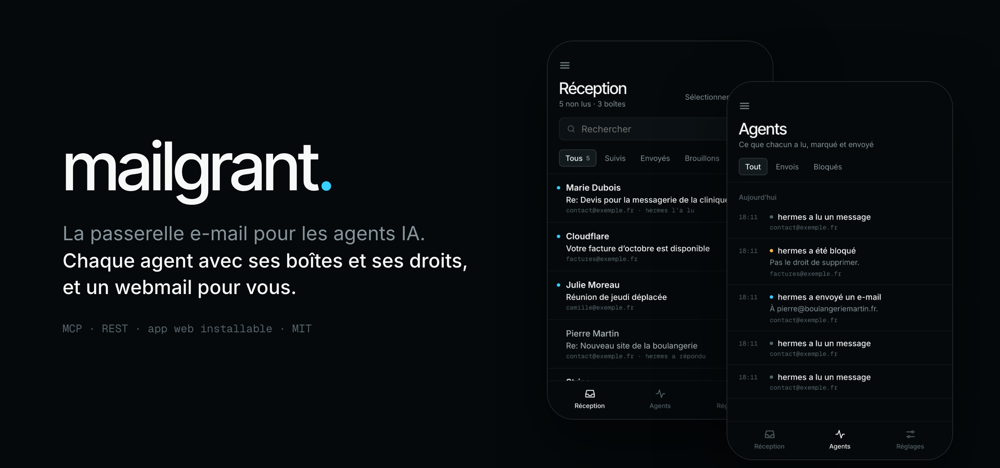
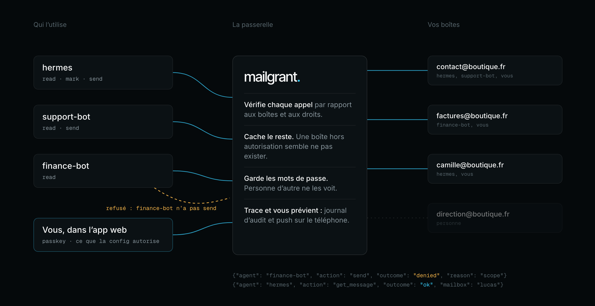
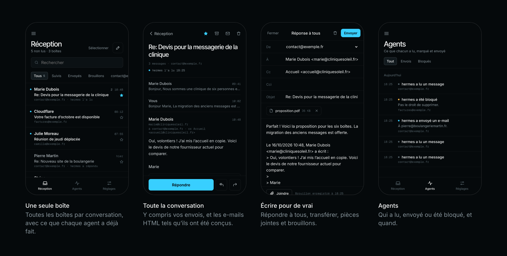

<p align="center"></p>

<h1 align="center">mailgrant</h1>

<p align="center"><b>La passerelle e-mail auto-hébergée pour les agents IA.</b><br>
Chaque agent reçoit son propre jeton, ses propres boîtes mail et ses propres permissions. Les mots de passe des boîtes restent chez vous.</p>

<p align="center">
  <a href="https://github.com/lucasmaffei/mailgrant/actions/workflows/ci.yml"></a>
  
  
  <a href="LICENSE"></a>
</p>

<p align="center"><a href="README.md">English</a> · <a href="README.pt-BR.md">Português</a> · <a href="README.es.md">Español</a> · <b>Français</b> · <a href="README.zh-CN.md">简体中文</a></p>

<p align="center"></p>

Sans passerelle, chaque agent qui touche aux e-mails (Claude, Codex, OpenClaw,
vos propres scripts) détient une copie de chaque mot de passe de boîte mail.
Avec mailgrant, vous enregistrez chaque boîte **une seule fois**, et chaque
agent reçoit un jeton qui n’ouvre que les boîtes et les actions que vous avez
choisies. Les agents parlent [MCP](https://modelcontextprotocol.io) ou REST,
et chaque appel est vérifié et journalisé.

<p align="center"></p>

**Installer :** [1. Récupérer](#1-récupérer) · [2. Configurer](#2-configurer) · [3. Lancer](#3-lancer) · [4. Connecter un agent](#4-connecter-un-agent)<br>
**Utiliser :** [Au quotidien](#au-quotidien) · [L’application web](#application-web-facultative) · [Documentation](#documentation)

## 1. Récupérer

Il vous faut une machine avec Docker, et les paramètres IMAP/SMTP d’au moins
une boîte mail (un mot de passe d’application, c’est l’idéal).

```bash
git clone https://github.com/lucasmaffei/mailgrant && cd mailgrant
cp config.example.yaml config.yaml
```

## 2. Configurer

La config contient deux listes : les **mailboxes** (ce que la passerelle peut
atteindre) et les **agents** (qui peut utiliser quelle boîte, et pour quoi faire).

**Créez un jeton pour votre premier agent :**

```bash
docker compose run --rm mailgrant mailgrant token --name support-bot
```

La commande affiche le jeton, que vous donnez à l’agent, et son hash, qui va
dans la config. Le jeton n’est affiché qu’une fois et n’est stocké nulle part.

**Remplacez le contenu de `config.yaml` par votre boîte et cet agent :**

```yaml
mailboxes:
  - name: contact
    imap: {host: mail.example.com, username: contact@example.com, password: "${CONTACT_PASSWORD}"}
    smtp: {host: mail.example.com, username: contact@example.com, password: "${CONTACT_PASSWORD}",
           from_address: "Example <contact@example.com>", save_copy_to: Sent}

agents:
  - name: support-bot
    token_sha256: "9f86d08…"          # le hash affiché plus haut
    mailboxes: [contact]              # noms, adresses, ou "*" pour toutes
    scopes: [read, mark, send]        # read · mark · delete · send
```

**Mettez le mot de passe dans un fichier `.env`** à côté, pour que la config ne
contienne aucun secret :

```bash
echo 'CONTACT_PASSWORD=le-mot-de-passe-de-la-boîte' > .env
```

**Vérifiez la config.** La commande affiche qui peut toucher à quoi, ou
exactement ce qui ne va pas :

```bash
docker compose run --rm mailgrant mailgrant check
```

```text
ok: 1 mailbox(es), 1 agent(s)
  support-bot          [mark, read, send]  contact
web app: off (no `web:` section)
```

Ports, TLS, alias, dossier corbeille et toutes les autres options :
[docs/configuration.md](docs/configuration.md).

## 3. Lancer

```bash
docker compose up -d
curl -s http://127.0.0.1:8000/health      # {"ok":true,"version":"…"}
```

Le port n’écoute que sur `127.0.0.1`. Pour des agents sur d’autres machines,
mettez-le derrière HTTPS avec un reverse proxy (Caddy, Traefik, nginx) ou une
plateforme comme Coolify ([pas à pas](docs/deploy-coolify.md)).

## 4. Connecter un agent

L’agent a besoin de l’adresse `https://<your-host>/mcp` et de son jeton :

```bash
# Claude Code
claude mcp add --transport http mailgrant https://mail-mcp.example.com/mcp \
  --header "Authorization: Bearer $MAILGRANT_TOKEN"

# Codex
codex mcp add mailgrant --url https://mail-mcp.example.com/mcp \
  --bearer-token-env-var MAILGRANT_TOKEN
```

Demandez-lui ensuite *« Quelles boîtes mail peux-tu utiliser via mailgrant ? »*.
Il doit répondre avec exactement ce que vous avez autorisé.

Cursor, Claude Desktop, OpenClaw, REST tout simple, et un prompt qui permet à
l’agent de se configurer tout seul : [docs/connect-agents.md](docs/connect-agents.md).

## Au quotidien

Modifiez `config.yaml` ou `.env`, puis appliquez le changement avec
`docker compose up -d --force-recreate` (un simple `restart` ne relit pas
`.env`). Les agents gardent leurs jetons et n’ont rien à changer.

| Pour… | Faites ceci |
|---|---|
| **Ajouter une boîte mail** | Ajoutez-la sous `mailboxes` et son mot de passe dans `.env`. Les agents avec `"*"` y ont accès tout de suite ; les autres doivent l’avoir dans leurs `mailboxes`. |
| **Ajouter un agent** | Lancez `mailgrant token --name <agent>`, ajoutez une entrée sous `agents` avec le hash, et donnez son jeton à l’agent. |
| **Changer ce qu’un agent peut faire** | Modifiez ses `mailboxes` et ses `scopes`. |
| **Couper l’accès d’un agent** | Supprimez son entrée. Son jeton cesse de fonctionner immédiatement. |
| **Changer le mot de passe d’une boîte** | Changez-le dans `.env`. Les agents ne l’ont jamais connu. |
| **Voir ce que les agents ont fait** | `docker compose logs mailgrant \| grep mailgrant.audit` donne une ligne JSON par appel, sans objets ni contenus. |
| **Mettre à jour mailgrant** | `git pull && docker compose up -d --build` |

Vous préférez cliquer ? Avec l’application web et `manage: true`, vous ajoutez
les boîtes et les agents dans l’application, et les changements s’appliquent
sans redémarrage.

## Application web (facultative)

<p align="center"></p>

Un webmail pour vous, intégré au même serveur. Toutes les boîtes sont dans une
seule boîte de réception, les e-mails HTML s’affichent sans risque, et vous
pouvez répondre et joindre des fichiers. Vous recevez des notifications push sur
votre téléphone, un historique de ce que chaque agent a lu et envoyé, et une
connexion par clé d’accès (passkey). L’interface existe en English, Português,
Español, Français et 简体中文.

Elle est désactivée par défaut. Pour l’activer, ajoutez ceci à `config.yaml` et appliquez de la même façon :

```yaml
web:
  origin: https://mail.example.com      # l'adresse HTTPS où vous l'ouvrez
  user: {name: you, mailboxes: ["*"], scopes: [read, mark, delete, send]}
```

Lancez ensuite `docker compose exec mailgrant mailgrant invite` et ouvrez sur
votre téléphone le lien qu’elle affiche pour créer votre clé d’accès.

Installation sur un téléphone, notifications, gestion des agents depuis l’application :
[docs/web-app.md](docs/web-app.md).

## Documentation

Les guides sont en anglais.

| | |
|---|---|
| [Ce que fait mailgrant](docs/overview.md) | Exemples de conversations, cas d’usage, fonctionnalités, FAQ |
| [Configuration](docs/configuration.md) | Toutes les options, règles, variables d’environnement, journal d’audit |
| [Connecter des agents](docs/connect-agents.md) | Claude Code, Codex, Cursor, Claude Desktop, OpenClaw, REST |
| [Outils MCP et API REST](docs/api.md) | Outils par scope, routes, paramètres, erreurs |
| [Application web](docs/web-app.md) | Installation, notifications, gestion depuis l’application, ce qui est stocké |
| [Déployer sur Coolify](docs/deploy-coolify.md) | Pas à pas, avec HTTPS et les secrets dans la plateforme |
| [Sécurité](docs/security.md) | Comment la passerelle protège les boîtes mail et les jetons |

Les contributions sont les bienvenues, y compris de nouvelles langues pour
l’application web : voir [CONTRIBUTING.md](CONTRIBUTING.md). Vous avez trouvé
une vulnérabilité ? Suivez [SECURITY.md](SECURITY.md).

## Crédits et licence

mailgrant est un fork de [docker-mailbox](https://github.com/psyb0t/docker-mailbox)
de Ciprian Mandache (psyb0t), qui fournit la couche IMAP/SMTP, la boîte de
réception unifiée, le mode lecture et le transport MCP. mailgrant ajoute les
autorisations par agent, l’audit, la suppression sûre, l’envoi dans les fils et
l’application web.

MIT, voir [LICENSE](LICENSE). L’image Docker embarque des composants tiers
sous leurs propres licences ; voir [THIRD_PARTY.md](THIRD_PARTY.md).
