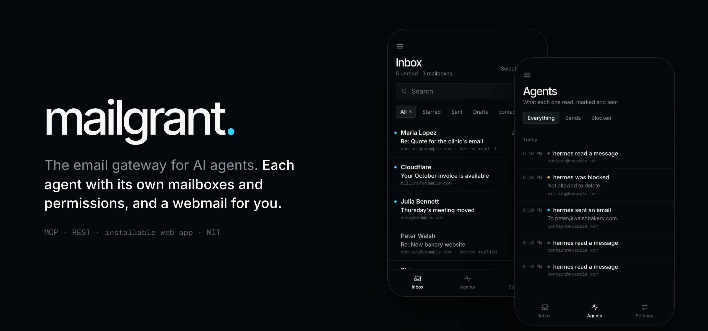
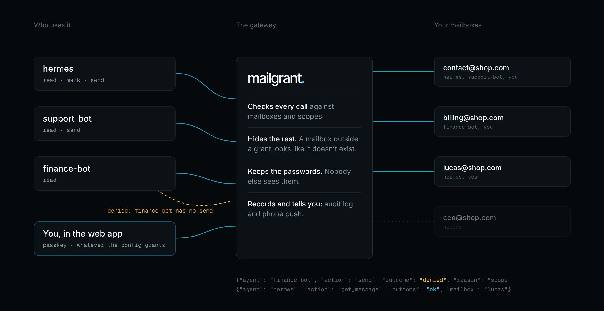

<p align="center"></p>

<h1 align="center">mailgrant</h1>

<p align="center"><b>The self-hosted email gateway for AI agents.</b><br>
Each agent gets its own token, its own mailboxes and its own permissions. The mailbox passwords stay with you.</p>

<p align="center">
  <a href="https://github.com/lucasmaffei/mailgrant/actions/workflows/ci.yml"></a>
  
  
  <a href="LICENSE"></a>
</p>

<p align="center"><b>English</b> · <a href="README.pt-BR.md">Português</a> · <a href="README.es.md">Español</a> · <a href="README.fr.md">Français</a> · <a href="README.zh-CN.md">简体中文</a></p>

<p align="center"></p>

Without a gateway, every agent that touches email (Claude, Codex, OpenClaw,
your own scripts) holds a copy of every mailbox password. With mailgrant you
register each mailbox **once**, and each agent gets a token that opens only the
mailboxes and actions you chose. Agents talk
[MCP](https://modelcontextprotocol.io) or REST, and every call is checked and
logged.

<p align="center"></p>

**Install:** [1. Get it](#1-get-it) · [2. Configure](#2-configure) · [3. Run](#3-run) · [4. Connect an agent](#4-connect-an-agent)<br>
**Use:** [Day to day](#day-to-day) · [The web app](#the-web-app-optional) · [Documentation](#documentation)

## 1. Get it

You need a machine with Docker, and the IMAP/SMTP details of at least one
mailbox (an app password is best).

```bash
git clone https://github.com/lucasmaffei/mailgrant && cd mailgrant
cp config.example.yaml config.yaml
```

## 2. Configure

The config holds two lists: **mailboxes** (what the gateway can reach) and
**agents** (who may use which mailbox, and for what).

**Create a token for your first agent:**

```bash
docker compose run --rm mailgrant mailgrant token --name support-bot
```

It prints the token, which you give to the agent, and its hash, which goes in
the config. The token is shown only once and isn't stored anywhere.

**Replace the contents of `config.yaml` with your mailbox and that agent:**

```yaml
mailboxes:
  - name: contact
    imap: {host: mail.example.com, username: contact@example.com, password: "${CONTACT_PASSWORD}"}
    smtp: {host: mail.example.com, username: contact@example.com, password: "${CONTACT_PASSWORD}",
           from_address: "Example <contact@example.com>", save_copy_to: Sent}

agents:
  - name: support-bot
    token_sha256: "9f86d08…"          # the hash printed above
    mailboxes: [contact]              # names, addresses, or "*" for all
    scopes: [read, mark, send]        # read · mark · delete · send
```

**Put the password in a `.env` file** next to it, so the config holds no
secret:

```bash
echo 'CONTACT_PASSWORD=the-mailbox-password' > .env
```

**Check the config.** It prints who may touch what, or exactly what is wrong:

```bash
docker compose run --rm mailgrant mailgrant check
```

```text
ok: 1 mailbox(es), 1 agent(s)
  support-bot          [mark, read, send]  contact
web app: off (no `web:` section)
```

Ports, TLS, aliases, the trash folder and every other option:
[docs/configuration.md](docs/configuration.md).

## 3. Run

```bash
docker compose up -d
curl -s http://127.0.0.1:8000/health      # {"ok":true,"version":"…"}
```

The port only listens on `127.0.0.1`. For agents on other machines, put it
behind HTTPS with a reverse proxy (Caddy, Traefik, nginx) or a platform like
Coolify ([step by step](docs/deploy-coolify.md)).

## 4. Connect an agent

The agent needs the address `https://<your-host>/mcp` and its token:

```bash
# Claude Code
claude mcp add --transport http mailgrant https://mail-mcp.example.com/mcp \
  --header "Authorization: Bearer $MAILGRANT_TOKEN"

# Codex
codex mcp add mailgrant --url https://mail-mcp.example.com/mcp \
  --bearer-token-env-var MAILGRANT_TOKEN
```

Then ask it *"Which mailboxes can you use through mailgrant?"*. It should
answer with exactly what you granted.

Cursor, Claude Desktop, OpenClaw, plain REST, and a prompt that lets the
agent set itself up: [docs/connect-agents.md](docs/connect-agents.md).

## Day to day

Edit `config.yaml` or `.env`, then apply the change with
`docker compose up -d --force-recreate` (a plain `restart` doesn't reread
`.env`). Agents keep their tokens and need no change.

| To… | Do this |
|---|---|
| **Add a mailbox** | Add it under `mailboxes` and its password to `.env`. Agents with `"*"` get it right away; others need it in their `mailboxes`. |
| **Add an agent** | Run `mailgrant token --name <agent>`, add an entry under `agents` with the hash, and give the agent its token. |
| **Change what an agent can do** | Edit its `mailboxes` and `scopes`. |
| **Cut an agent off** | Remove its entry. Its token stops working at once. |
| **Change a mailbox password** | Change it in `.env`. Agents never knew it. |
| **See what agents did** | `docker compose logs mailgrant \| grep mailgrant.audit` gives one JSON line per call, without subjects or bodies. |
| **Update mailgrant** | `git pull && docker compose up -d --build` |

Would you rather click? With the web app and `manage: true`, you add
mailboxes and agents in the app, and changes apply without a restart.

## The web app (optional)

<p align="center"></p>

A webmail for you, built into the same server. Every mailbox is in one
inbox, HTML mail shows safely, and you can reply and attach files. You get
push notifications on your phone, a timeline of what each agent read and
sent, and passkey sign-in. It comes in English, Português, Español, Français
and 简体中文.

It is off by default. To turn it on, add this to `config.yaml` and apply it the same way:

```yaml
web:
  origin: https://mail.example.com      # the HTTPS address you open it at
  user: {name: you, mailboxes: ["*"], scopes: [read, mark, delete, send]}
```

Then run `docker compose exec mailgrant mailgrant invite` and open the link
it prints on your phone to create your passkey.

Installing it on a phone, notifications, managing agents from the app:
[docs/web-app.md](docs/web-app.md).

## Documentation

| | |
|---|---|
| [What it does](docs/overview.md) | Example conversations, use cases, features, FAQ |
| [Configuration](docs/configuration.md) | Every option, rules, environment variables, audit log |
| [Connect agents](docs/connect-agents.md) | Claude Code, Codex, Cursor, Claude Desktop, OpenClaw, REST |
| [MCP tools and REST API](docs/api.md) | Tools per scope, routes, parameters, errors |
| [Web app](docs/web-app.md) | Install, notifications, managing from the app, what is stored |
| [Deploy on Coolify](docs/deploy-coolify.md) | Step by step, with HTTPS and secrets in the platform |
| [Security](docs/security.md) | How the gateway protects mailboxes and tokens |

Contributions are welcome, including new languages for the web app: see
[CONTRIBUTING.md](CONTRIBUTING.md). Found a vulnerability? Follow
[SECURITY.md](SECURITY.md).

## Credits and license

mailgrant is a fork of [docker-mailbox](https://github.com/psyb0t/docker-mailbox)
by Ciprian Mandache (psyb0t), which provides the IMAP/SMTP layer, the unified
inbox, reader mode and the MCP transport. mailgrant adds per-agent grants,
auditing, safe deletion, threaded sending and the web app.

MIT, see [LICENSE](LICENSE). The Docker image bundles third-party components
under their own licenses; see [THIRD_PARTY.md](THIRD_PARTY.md).
