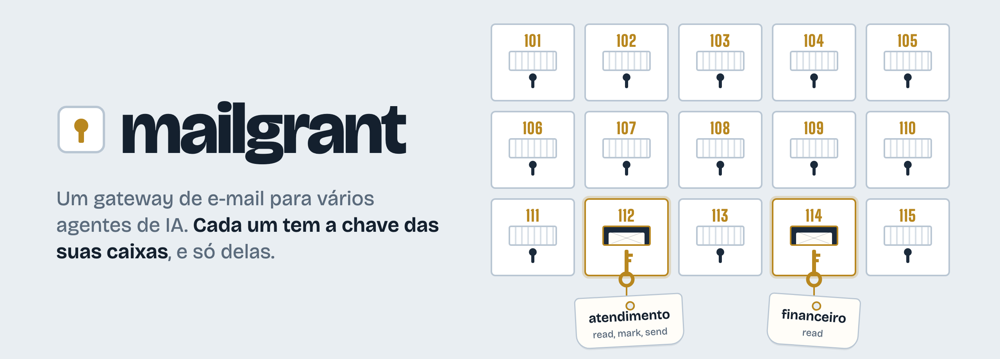
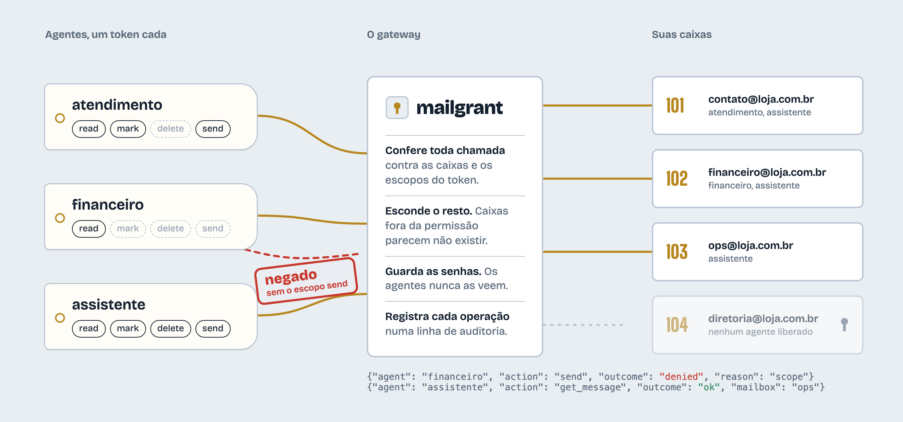

<h1 align="center">
<picture>
  <source media="(prefers-color-scheme: dark)" srcset="docs/assets/hero-dark.pt-BR.png">
  
</picture>
</h1>

<p>
  <a href="https://github.com/lucasmaffei/mailgrant/actions/workflows/ci.yml"></a>
  
  
  
  <a href="LICENSE"></a>
</p>

[English](README.md) · [Deploy no Coolify](docs/deploy-coolify.md) · [Conectar agentes](docs/connect-agents.md) · [Changelog](CHANGELOG.md)

O mailgrant fica entre os seus agentes e as suas caixas IMAP/SMTP. Você
cadastra cada caixa **uma vez** e entrega a cada agente um token que libera
caixas e ações específicas. Os agentes falam MCP (Streamable HTTP) ou REST; o
mailgrant aplica a permissão em toda chamada e registra quem fez o quê.

<picture>
  <source media="(prefers-color-scheme: dark)" srcset="docs/assets/how-it-works-dark.pt-BR.png">
  
</picture>

## Por quê

Os agentes se multiplicam, e as caixas também. Sem um gateway, cada agente
guarda a própria cópia de cada senha, no próprio servidor, no próprio harness.
Caixa nova significa passar em todos os agentes; tirar um acesso significa
torcer para ter achado todas as cópias.

Com o mailgrant:

- **Caixa nova** é uma entrada num arquivo. Agentes com `"*"` passam a vê-la na hora; os outros, com mais uma linha.
- **Revogar** um agente é apagar o token dele. A senha das caixas nunca sai do gateway.
- **Mínimo privilégio de verdade**: um agente só-leitura não envia, não apaga nem marca como lido — e nem enxerga essas ferramentas.
- **Dá para auditar**: uma linha JSON por operação, permitida ou negada.

## Recursos

- **Permissão por agente** — caixas por nome, endereço ou `*`; escopos `read`, `mark`, `delete`, `send`.
- **Invisível fora da permissão** — uma caixa que o agente não pode usar responde igual a uma que não existe.
- **Lista de ferramentas filtrada** — o `tools/list` do MCP só mostra o que o token pode chamar.
- **Caixa de entrada unificada** — uma chamada busca em todas as caixas liberadas, em paralelo, da mais nova para a mais antiga.
- **Modo leitura** — HTML convertido em texto limpo para o modelo ler.
- **Apagar com segurança** — vai para a lixeira; apagar de vez exige `permanent=true` e só afeta aquela mensagem.
- **Respostas na conversa certa** — `in_reply_to` / `references` no envio; cópia opcional de cada envio na pasta Enviados.
- **Sem falsificar remetente** — `from_address` limitado ao endereço da caixa e aos apelidos declarados.
- **Auditoria** — só metadados, nunca assunto nem corpo.
- **Sem estado** — sem banco de dados. A conexão abre por requisição e fecha.
- **Segredos no ambiente** — `${VARIAVEL}` em qualquer ponto do config, ou o config inteiro em `MAILGRANT_CONFIG_YAML`.

## Casos de uso

| Caso | Caixas | Escopos |
|---|---|---|
| **Atendimento.** Um agente responde o endereço de contato dentro da conversa original, e a resposta fica em Enviados pra equipe ver. | `contato@` | `read`, `mark`, `send` |
| **Financeiro.** Um agente lê boletos, notas e comprovantes pra conciliar pagamentos. Não responde nem apaga nada. | `financeiro@` | `read` |
| **Resumo diário.** Um script agendado resume toda manhã o que chegou sem ler em todas as caixas. | `*` | `read` |
| **Assistente pessoal.** Faz a triagem da sua caixa: marca o que já foi visto, manda newsletter pra lixeira, responde o rotineiro. | `voce@` | `read`, `mark`, `delete`, `send` |
| **Agência com vários clientes.** O agente de cada cliente só alcança as caixas daquele cliente, mesmo rodando no mesmo servidor. | `cliente-a@`, `financeiro@cliente-a` | `read`, `send` |
| **Entrada de leads.** Um agente comercial lê os avisos do formulário do site e responde os contatos novos pelo `vendas@`, sem enxergar mais nada. | `vendas@` | `read`, `send` |

Em todos, trocar a senha de uma caixa, tirar o acesso de um agente ou somar
uma caixa nova é uma mudança no gateway. Nenhum agente precisa ser mexido.

## Começo rápido

```bash
git clone https://github.com/lucasmaffei/mailgrant && cd mailgrant
cp config.example.yaml config.yaml

# 1. Gere um token por agente. O token vai para o agente; o hash fica no config.
docker run --rm ghcr.io/lucasmaffei/mailgrant:latest mailgrant token --name atendimento

# 2. Edite o config.yaml: suas caixas e os agentes com seus hashes.
# 3. Valide — mostra quem acessa o quê.
docker run --rm -v "$PWD/config.yaml:/etc/mailgrant/config.yaml:ro" \
  ghcr.io/lucasmaffei/mailgrant:latest mailgrant check

# 4. Suba (publicado só em 127.0.0.1; ponha TLS na frente antes de expor).
docker compose up -d
curl -s http://127.0.0.1:8000/health
curl -s -H "Authorization: Bearer $TOKEN" http://127.0.0.1:8000/whoami
```

Sem acesso à imagem publicada? `docker compose up -d --build` constrói a partir do código.

## Configuração

```yaml
agents:
  - name: atendimento
    token_sha256: "9f86d08…"          # do `mailgrant token`; ou token: "${TOKEN_ATENDIMENTO}"
    mailboxes: [contato]              # nomes, endereços ou "*"
    scopes: [read, mark, send]

mailboxes:
  - name: contato
    imap:
      host: mail.exemplo.com.br       # porta 993 e tls ssl por padrão
      username: contato@exemplo.com.br
      password: "${SENHA_CONTATO}"
    smtp:
      host: mail.exemplo.com.br
      port: 465
      tls: ssl
      username: contato@exemplo.com.br
      password: "${SENHA_CONTATO}"
      from_address: "Exemplo <contato@exemplo.com.br>"
      allowed_from: [vendas@exemplo.com.br]
      save_copy_to: Sent
```

O [`config.example.yaml`](config.example.yaml) documenta todas as opções.

### Escopos

| Escopo | Ferramentas MCP | REST |
|---|---|---|
| — | `whoami` | `GET /whoami` |
| `read` | `mailboxes`, `inbox`, `list_folders`, `list_messages`, `search`, `get_message` | `GET /mailboxes`, `/inbox`, `/mailboxes/{name}/…` |
| `mark` | `mark_seen` | `POST /mailboxes/{name}/messages/{uid}/seen` |
| `delete` | `delete_message` | `DELETE /mailboxes/{name}/messages/{uid}` |
| `send` | `send` | `POST /mailboxes/{name}/send` |

Ler nunca altera a mensagem: as pastas são abertas em modo somente leitura
(`EXAMINE`), então a marcação de lido fica como as pessoas deixaram.

### Regras que vale saber

- As permissões são conferidas na inicialização: erro de digitação nas `mailboxes` de um agente impede o servidor de subir, em vez de não liberar nada em silêncio.
- O mesmo token (ou hash) em dois agentes é erro.
- `token_sha256` deixa o arquivo sem nenhum segredo utilizável; `token: "${VAR}"` deixa o segredo no ambiente. Os dois funcionam.
- `auth.tokens` (herança do docker-mailbox) continua funcionando e libera tudo para quem tiver o token. O `mailgrant check` avisa.
- Mudou o config, reinicie o serviço.

### Opções da caixa

| Chave | Padrão | Observação |
|---|---|---|
| `imap.port` / `imap.tls` | `993` / `ssl` | `tls`: `ssl`, `starttls`, `none` |
| `imap.default_folder` | `INBOX` | |
| `imap.trash_folder` | automático | Pasta marcada `\Trash`, depois `Trash`, `Deleted Items`, `Lixeira` |
| `smtp.port` / `smtp.tls` | `587` / `starttls` | |
| `smtp.from_address` | — | Obrigatório. `From:` padrão |
| `smtp.allowed_from` | `[]` | Outros `From:` permitidos |
| `smtp.save_copy_to` | — | Pasta IMAP que recebe a cópia de cada envio (precisa de `imap`) |

## Conectando agentes

Qualquer cliente MCP com Streamable HTTP e cabeçalho de autenticação funciona.
Passo a passo completo: **[docs/connect-agents.md](docs/connect-agents.md)**.

```bash
# Claude Code
claude mcp add --transport http mailgrant https://mail-mcp.exemplo.com.br/mcp \
  --header "Authorization: Bearer $MAILGRANT_TOKEN"

# Codex
codex mcp add mailgrant --url https://mail-mcp.exemplo.com.br/mcp \
  --bearer-token-env-var MAILGRANT_TOKEN

# Clientes que só abrem servidores stdio (OpenClaw e afins)
npx -y mcp-remote@0.1.38 https://mail-mcp.exemplo.com.br/mcp \
  --transport http-only --header "Authorization: Bearer $MAILGRANT_TOKEN"
```

Dê aos agentes a skill em [`.agents/skills/mailgrant/SKILL.md`](.agents/skills/mailgrant/SKILL.md):
ela ensina a conferir o `whoami` primeiro, responder dentro da conversa e
confirmar antes de apagar.

### Deixe o próprio agente se configurar

Gere o token do agente, ponha na variável `MAILGRANT_TOKEN` do ambiente onde
ele roda e cole este prompt na conversa com ele (troque a URL):

```text
Conecte-se ao meu gateway de e-mail mailgrant.

- Endpoint MCP: https://mail-mcp.exemplo.com.br/mcp
- Seu token está na variável de ambiente MAILGRANT_TOKEN. Nunca o mostre, não o
  grave em arquivo em texto puro e não o envie a lugar nenhum além do cabeçalho
  Authorization desse endpoint.

Passos:
1. Descubra em qual harness você está rodando e adicione um servidor MCP remoto
   chamado "mailgrant", com a URL acima e o cabeçalho
   "Authorization: Bearer <token>":
   - Claude Code: claude mcp add --scope user --transport http mailgrant <url> --header "Authorization: Bearer $MAILGRANT_TOKEN"
   - Codex: codex mcp add mailgrant --url <url> --bearer-token-env-var MAILGRANT_TOKEN
   - Outro: registre na sua configuração de MCP como servidor Streamable HTTP
     com esse cabeçalho. Se você só consegue abrir servidores stdio, use
     npx -y mcp-remote@0.1.38 <url> --transport http-only --header "Authorization:${AUTH_HEADER}"
     com AUTH_HEADER="Bearer <token>" no env do processo.
2. Instale a skill de uso que está em
   https://github.com/lucasmaffei/mailgrant/tree/main/.agents/skills/mailgrant
   (no Claude Code: ~/.claude/skills/mailgrant/SKILL.md). Se você não instala
   skills, leia o arquivo e siga as regras dele.
3. Recarregue os servidores MCP se o seu harness exigir e chame a ferramenta whoami.
4. Me responda: qual agente você é, seus escopos, as caixas que pode usar e
   quantas mensagens não lidas há em cada uma (inbox com unseen=true). Não
   marque nada como lido, não apague e não envie nada.
```

Se o agente responder com o próprio nome, os escopos e as caixas certas, está
pronto. Se receber `401`, o token não confere com nenhum hash do config.

## API REST

Toda rota, menos `/health`, exige `Authorization: Bearer <token>`.

| Método | Caminho | Escopo | Faz |
|---|---|---|---|
| `GET` | `/health` | — | Verificação de vida, sempre aberta |
| `GET` | `/whoami` | — | Agente, escopos e caixas deste token |
| `GET` | `/mailboxes` | read | Caixas liberadas |
| `GET` | `/inbox` | read | Busca unificada nas caixas liberadas |
| `GET` | `/mailboxes/{name}/folders` | read | Pastas IMAP |
| `GET` | `/mailboxes/{name}/messages?folder=&limit=&search=` | read | Cabeçalhos, mais novos primeiro (busca IMAP crua) |
| `GET` | `/mailboxes/{name}/search?from=&subject=&…` | read | Busca estruturada numa caixa |
| `GET` | `/mailboxes/{name}/messages/{uid}?folder=&reader=` | read | Mensagem completa; `reader=true` acrescenta `body_reader` |
| `POST` | `/mailboxes/{name}/messages/{uid}/seen` | mark | Corpo `{"seen": true\|false}` |
| `DELETE` | `/mailboxes/{name}/messages/{uid}?folder=&permanent=` | delete | Move para a lixeira, ou apaga de vez |
| `POST` | `/mailboxes/{name}/send` | send | Envia |

`{name}` também aceita o endereço da caixa. `/inbox` e `/search` aceitam
`from`, `to`, `subject`, `body`, `text`, `since`, `before` (datas IMAP como
`14-Oct-2026`), `unseen`, `seen`, `flagged`, `answered`, `larger_than`,
`smaller_than`, `folder` e `limit` (≤ 500); `/inbox` aceita também `mailbox`
(nomes ou endereços separados por vírgula).

Corpo do envio:

```json
{
  "to": ["cliente@exemplo.com"], "cc": [], "bcc": [],
  "subject": "Re: Pedido 42",
  "body_text": "…",
  "in_reply_to": "<message-id-original@exemplo.com>"
}
```

Erros vêm em JSON `{"detail": "…"}`: `401` token ausente ou inválido · `403`
falta escopo ou `from_address` não permitido · `404` caixa inexistente **ou
não liberada** · `409` caixa sem IMAP/SMTP · `502` o servidor de e-mail recusou.

## Auditoria

Com `audit_log: true` (padrão), cada operação gera uma linha no logger
`mailgrant.audit`, na saída padrão:

```json
{"ts": "2026-10-14T22:01:08+00:00", "agent": "atendimento", "action": "get_message", "outcome": "ok", "mailbox": "contato", "uid": "42"}
{"ts": "2026-10-14T22:01:09+00:00", "agent": "atendimento", "action": "delete_message", "outcome": "denied", "reason": "scope", "mailbox": "contato"}
```

Assunto e corpo nunca vão para o log.

## Segurança

- **Rode atrás de TLS.** Tokens e e-mails passam por ele. O compose publica em `127.0.0.1` por padrão; exponha só por um proxy HTTPS.
- **O config guarda senhas de caixas.** Prefira `${VAR}` ou `MAILGRANT_CONFIG_YAML` vindos do cofre de segredos da sua plataforma; nunca versione um `config.yaml` preenchido.
- **Tokens comparados em tempo constante**, todos os candidatos a cada requisição.
- **Injeção de comando IMAP** bloqueada na entrada: caracteres de controle recusados, nomes de pasta entre aspas, UID só com dígitos.
- **Apagar nunca surpreende**: lixeira primeiro, `UID EXPUNGE` de uma única mensagem, recusa em servidores sem UIDPLUS.
- **Um token é tão estreito quanto a permissão dele.** Dê a cada agente o mínimo de caixas e escopos; `"*"` só para quem você confiaria todas.

## Rodando pelo código

```bash
uv sync --all-groups
uv run mailgrant check --config config.yaml
uv run mailgrant http --config config.yaml   # escuta em 127.0.0.1:8000
uv run pytest -q
```

## Créditos

O mailgrant é um fork do [docker-mailbox](https://github.com/psyb0t/docker-mailbox),
de Ciprian Mandache (psyb0t), que fornece a camada IMAP/SMTP, a caixa de
entrada unificada, o modo leitura e o transporte MCP. O mailgrant acrescenta
permissões por agente, auditoria, exclusão segura e envio dentro da conversa.

## Licença

MIT — veja [LICENSE](LICENSE). A imagem Docker inclui o `html2text` (GPL-3.0);
veja [THIRD_PARTY.md](THIRD_PARTY.md).
