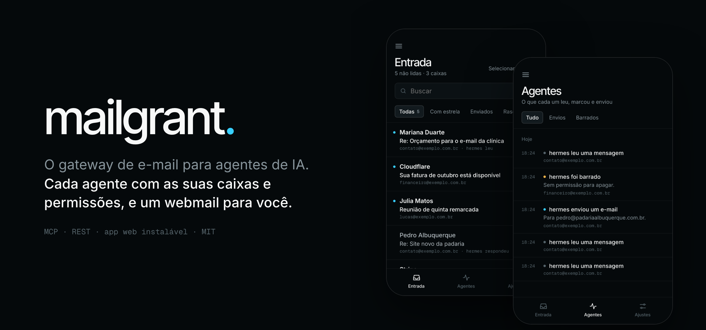
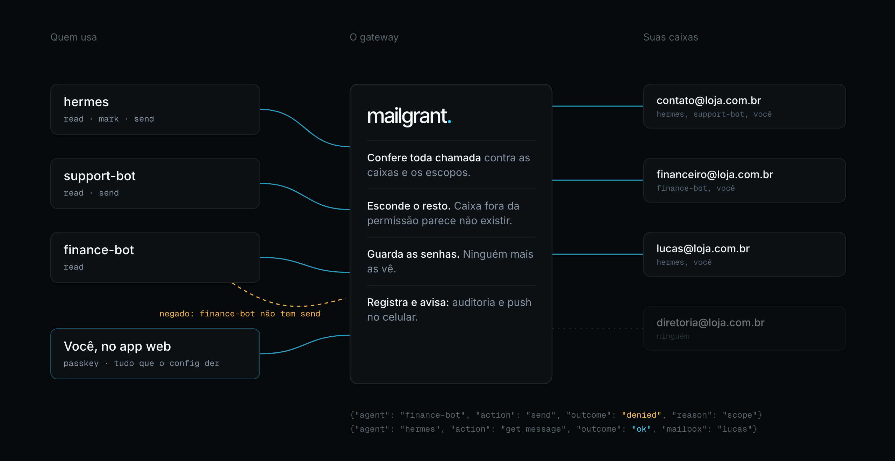
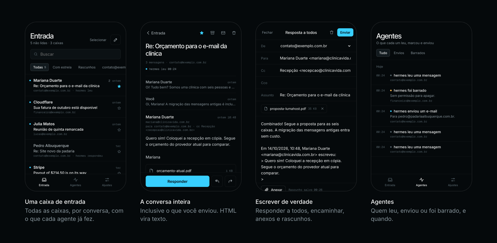

<p align="center"></p>

<h1 align="center">mailgrant</h1>

<p align="center"><b>O gateway de e-mail self-hosted para agentes de IA.</b><br>
Cada agente recebe o próprio token, as próprias caixas e as próprias permissões. As senhas das caixas ficam com você.</p>

<p align="center">
  <a href="https://github.com/lucasmaffei/mailgrant/actions/workflows/ci.yml"></a>
  
  
  <a href="LICENSE"></a>
</p>

<p align="center"><a href="README.md">English</a> · <b>Português</b> · <a href="README.es.md">Español</a> · <a href="README.fr.md">Français</a> · <a href="README.zh-CN.md">简体中文</a></p>

<p align="center"></p>

Sem um gateway, todo agente que mexe com e-mail (Claude, Codex, OpenClaw, os
seus próprios scripts) guarda uma cópia da senha de cada caixa. Com o
mailgrant você cadastra cada caixa **uma vez**, e cada agente recebe um token
que abre só as caixas e as ações que você escolheu. Os agentes falam
[MCP](https://modelcontextprotocol.io) ou REST, e toda chamada é conferida e
registrada.

<p align="center"></p>

**Instalar:** [1. Baixe](#1-baixe) · [2. Configure](#2-configure) · [3. Rode](#3-rode) · [4. Conecte um agente](#4-conecte-um-agente)<br>
**Usar:** [No dia a dia](#no-dia-a-dia) · [O app web](#o-app-web-opcional) · [Documentação](#documentação)

## 1. Baixe

Você precisa de uma máquina com Docker e dos dados IMAP/SMTP de pelo menos
uma caixa (de preferência uma senha de app).

```bash
git clone https://github.com/lucasmaffei/mailgrant && cd mailgrant
cp config.example.yaml config.yaml
```

## 2. Configure

A configuração tem duas listas: **caixas** (o que o gateway alcança) e
**agentes** (quem pode usar qual caixa, e para quê).

**Crie um token para o seu primeiro agente:**

```bash
docker compose run --rm mailgrant mailgrant token --name support-bot
```

Ele mostra o token, que você entrega ao agente, e o hash dele, que vai na
configuração. O token aparece uma vez só e não fica guardado em lugar nenhum.

**Troque o conteúdo do `config.yaml` pela sua caixa e por esse agente:**

```yaml
mailboxes:
  - name: contato
    imap: {host: mail.exemplo.com.br, username: contato@exemplo.com.br, password: "${CONTATO_PASSWORD}"}
    smtp: {host: mail.exemplo.com.br, username: contato@exemplo.com.br, password: "${CONTATO_PASSWORD}",
           from_address: "Exemplo <contato@exemplo.com.br>", save_copy_to: Sent}

agents:
  - name: support-bot
    token_sha256: "9f86d08…"          # o hash mostrado acima
    mailboxes: [contato]              # nomes, endereços, ou "*" para todas
    scopes: [read, mark, send]        # read · mark · delete · send
```

**Ponha a senha num arquivo `.env`** ao lado, para que a configuração não
guarde nenhum segredo:

```bash
echo 'CONTATO_PASSWORD=a-senha-da-caixa' > .env
```

**Confira a configuração.** Ela mostra quem pode mexer em quê, ou exatamente o
que está errado:

```bash
docker compose run --rm mailgrant mailgrant check
```

```text
ok: 1 mailbox(es), 1 agent(s)
  support-bot          [mark, read, send]  contato
web app: off (no `web:` section)
```

Portas, TLS, apelidos, a pasta de lixeira e todas as outras opções:
[docs/configuration.md](docs/configuration.md) (em inglês).

## 3. Rode

```bash
docker compose up -d
curl -s http://127.0.0.1:8000/health      # {"ok":true,"version":"…"}
```

A porta só escuta em `127.0.0.1`. Para agentes em outras máquinas, coloque o
gateway atrás de HTTPS com um proxy reverso (Caddy, Traefik, nginx) ou uma
plataforma como o Coolify ([passo a passo](docs/deploy-coolify.md)).

## 4. Conecte um agente

O agente precisa do endereço `https://<seu-host>/mcp` e do token dele:

```bash
# Claude Code
claude mcp add --transport http mailgrant https://mail-mcp.exemplo.com.br/mcp \
  --header "Authorization: Bearer $MAILGRANT_TOKEN"

# Codex
codex mcp add mailgrant --url https://mail-mcp.exemplo.com.br/mcp \
  --bearer-token-env-var MAILGRANT_TOKEN
```

Depois pergunte a ele *"Quais caixas você pode usar pelo mailgrant?"*. Ele deve
responder exatamente o que você liberou.

Cursor, Claude Desktop, OpenClaw, REST puro, e um prompt para o agente se
configurar sozinho: [docs/connect-agents.md](docs/connect-agents.md).

## No dia a dia

Edite o `config.yaml` ou o `.env` e aplique a mudança com
`docker compose up -d --force-recreate` (um `restart` simples não relê o
`.env`). Os agentes continuam com os mesmos tokens e não precisam de mudança.

| Para… | Faça isto |
|---|---|
| **Adicionar uma caixa** | Ponha a caixa em `mailboxes` e a senha dela no `.env`. Agentes com `"*"` já ganham acesso; os outros precisam dela em `mailboxes`. |
| **Adicionar um agente** | Rode `mailgrant token --name <agente>`, crie uma entrada em `agents` com o hash e entregue o token ao agente. |
| **Mudar o que um agente pode fazer** | Edite os `mailboxes` e os `scopes` dele. |
| **Cortar um agente** | Apague a entrada dele. O token para de funcionar na hora. |
| **Trocar a senha de uma caixa** | Troque no `.env`. Os agentes nunca a conheceram. |
| **Ver o que os agentes fizeram** | `docker compose logs mailgrant \| grep mailgrant.audit` mostra uma linha JSON por chamada, sem assunto nem corpo. |
| **Atualizar o mailgrant** | `git pull && docker compose up -d --build` |

Prefere clicar? Com o app web e `manage: true`, você adiciona caixas e
agentes pelo app, e as mudanças valem sem reiniciar nada.

## O app web (opcional)

<p align="center"></p>

Um webmail para você, no mesmo servidor. Todas as caixas ficam numa entrada
só, o e-mail HTML aparece com segurança, e você responde e anexa arquivos.
Você recebe notificações push no celular, vê uma linha do tempo do que cada
agente leu e enviou, e entra com passkey. Ele vem em English, Português,
Español, Français e 简体中文.

Ele vem desligado. Para ligar, acrescente isto ao `config.yaml` e aplique do
mesmo jeito:

```yaml
web:
  origin: https://mail.exemplo.com.br   # o endereço HTTPS onde você abre o app
  user: {name: voce, mailboxes: ["*"], scopes: [read, mark, delete, send]}
```

Depois rode `docker compose exec mailgrant mailgrant invite` e abra no celular
o link que ele mostra, para criar a sua passkey.

Instalar no celular, notificações, gerenciar agentes pelo app:
[docs/web-app.pt-BR.md](docs/web-app.pt-BR.md).

## Documentação

Fora o guia do app web, a documentação está em inglês.

| | |
|---|---|
| [O que ele faz](docs/overview.md) | Exemplos de conversa, casos de uso, recursos, perguntas frequentes |
| [Configuração](docs/configuration.md) | Todas as opções, regras, variáveis de ambiente, log de auditoria |
| [Conectar agentes](docs/connect-agents.md) | Claude Code, Codex, Cursor, Claude Desktop, OpenClaw, REST |
| [Ferramentas MCP e API REST](docs/api.md) | Ferramentas por escopo, rotas, parâmetros, erros |
| [App web](docs/web-app.pt-BR.md) | Instalação, notificações, gerenciar pelo app, o que fica guardado |
| [Publicar no Coolify](docs/deploy-coolify.md) | Passo a passo, com HTTPS e segredos na plataforma |
| [Segurança](docs/security.md) | Como o gateway protege as caixas e os tokens |

Contribuições são bem-vindas, inclusive novos idiomas para o app web: veja o
[CONTRIBUTING.md](CONTRIBUTING.md). Achou uma vulnerabilidade? Siga o
[SECURITY.md](SECURITY.md).

## Créditos e licença

O mailgrant é um fork do [docker-mailbox](https://github.com/psyb0t/docker-mailbox),
de Ciprian Mandache (psyb0t), que fornece a camada IMAP/SMTP, a caixa de
entrada unificada, o modo leitura e o transporte MCP. O mailgrant acrescenta
permissões por agente, auditoria, exclusão segura, envio dentro da conversa e
o app web.

MIT, veja a [LICENSE](LICENSE). A imagem Docker inclui componentes de
terceiros com as próprias licenças; veja o [THIRD_PARTY.md](THIRD_PARTY.md).
