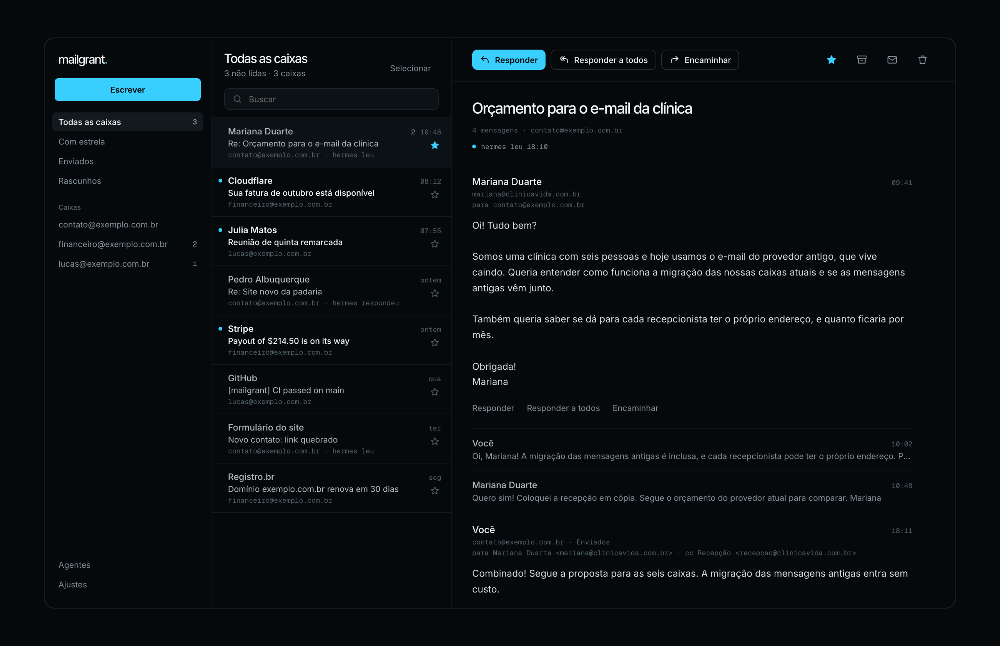

<p align="center"></p>

<h1 align="center">mailgrant</h1>

<p align="center"><b>O gateway de e-mail self-hosted para agentes de IA.</b><br>
Um único endpoint MCP e REST na frente das suas caixas IMAP/SMTP: cada agente recebe o próprio token, as próprias caixas e as próprias permissões, e você ganha um webmail para acompanhar tudo.</p>

<p align="center">
  <a href="https://github.com/lucasmaffei/mailgrant/actions/workflows/ci.yml"></a>
  
  
  
  <a href="LICENSE"></a>
</p>

<p align="center"><a href="README.md">English</a> · <b>Português</b> · <a href="README.es.md">Español</a> · <a href="README.fr.md">Français</a> · <a href="README.zh-CN.md">简体中文</a></p>

<p align="center"></p>

Claude, Codex, OpenClaw, Hermes, os seus próprios scripts: todo agente que mexe
com e-mail acaba guardando uma cópia da senha de cada caixa, no próprio
servidor, na própria configuração. O mailgrant é um servidor MCP de e-mail que
fica, sozinho, na frente das caixas. Você cadastra cada caixa **uma vez** e
decide quem pode usar quais caixas e quais ações:

- **Agentes** recebem um token bearer e falam [MCP](https://modelcontextprotocol.io) (Streamable HTTP) ou REST puro.
- **Você** ganha um webmail opcional no celular e no computador, com login por passkey, notificações push e uma linha do tempo de tudo o que cada agente fez.

Toda chamada, de qualquer um dos lados, passa pelas mesmas permissões e pelo mesmo log de auditoria.

<p align="center"></p>

## Conteúdo

[Na prática](#na-prática) · [Recursos](#recursos) · [Começo rápido](#começo-rápido) · [Conecte um agente](#conecte-um-agente) · [O app web](#o-app-web) · [Configuração](#configuração) · [API REST](#api-rest) · [Segurança](#segurança) · [Perguntas frequentes](#perguntas-frequentes)

## Na prática

Com o agente conectado, é só pedir. Ele só enxerga as ferramentas e as caixas
que o token dele permite.

> **Você:** O que chegou hoje no contact@ que ainda precisa de resposta?
>
> **O agente** chama `inbox(mailbox="contact", unseen=true, since="16-Oct-2026")` e depois `get_message` em cada uma:
>
> 3 não lidas. A Mariana (clínica, 6 pessoas) quer um orçamento para migrar as caixas.
> O Pedro aprovou a versão 2 do site da padaria. Um aviso do formulário diz que o link
> da campanha de outubro abre a página errada. Quer que eu responda a Mariana?

> **Você:** Quero, responda na mesma conversa com a nossa tabela de preços e marque as outras duas como lidas.
>
> **O agente** chama `send(mailbox="contact", to=["mariana@…"], in_reply_to="<…>", …)` e `mark_seen` duas vezes.
> A resposta cai na pasta Enviados da caixa, dentro da conversa, onde a sua equipe (e o app web) consegue ver.

> **Um agente financeiro só de leitura** tenta `send(mailbox="billing", …)` e recebe
> `403 scope`. Ele nem chegou a ver uma ferramenta `send`, e a tentativa
> aparece como **negada** no seu log de auditoria e no app.

Para que as pessoas usam:

| Caso | Caixas | Escopos |
|---|---|---|
| **Atendimento.** Um agente responde o endereço de contato dentro da conversa original, e a resposta fica em Enviados para a equipe ver. | `contact@` | `read`, `mark`, `send` |
| **Financeiro.** Um agente lê faturas e comprovantes para conciliar pagamentos. Não responde nem apaga nada. | `billing@` | `read` |
| **Resumo diário.** Um script agendado resume toda manhã o que chegou sem ler em todas as caixas. | `*` | `read` |
| **Assistente pessoal.** Faz a triagem da sua própria caixa: marca o que você já viu, manda newsletter para a lixeira, responde o rotineiro. | `you@` | `read`, `mark`, `delete`, `send` |
| **Agência com vários clientes.** O agente de cada cliente só alcança as caixas daquele cliente, mesmo no mesmo servidor. | `client-a@`, `billing@client-a` | `read`, `send` |
| **Entrada de leads.** Um agente comercial lê os avisos do formulário do site e responde os leads novos pelo `sales@`, sem enxergar mais nada. | `sales@` | `read`, `send` |

Trocar a senha de uma caixa, cortar o acesso de um agente ou somar uma caixa é
uma mudança no gateway. Nenhum agente precisa ser mexido.

## Recursos

- **Permissão por agente**: caixas por nome, endereço ou `*` (inclusive as que vierem depois); escopos `read`, `mark`, `delete`, `send`.
- **Invisível fora da permissão**: uma caixa que o agente não pode usar responde exatamente igual a uma que não existe.
- **Lista de ferramentas filtrada**: o `tools/list` do MCP só mostra as ferramentas que o token pode chamar.
- **Caixa de entrada unificada**: uma chamada busca em todas as caixas liberadas, em paralelo.
- **Apagar com segurança**: vai para a lixeira; apagar de vez exige `permanent=true` e afeta uma mensagem só.
- **Respostas na conversa certa** com `in_reply_to`, e uma cópia de cada envio na pasta Enviados.
- **Sem falsificar remetente**: `from_address` limitado ao endereço da própria caixa e aos apelidos declarados.
- **Log de auditoria**: só metadados, nunca assunto nem corpo.
- **Modo leitura** para os agentes: e-mail em HTML volta como texto limpo.
- **Webmail opcional**: PWA instalável com passkeys, push, conversas, rascunhos, e-mail em HTML num sandbox e a atividade dos agentes. Em English, Português, Español, Français e 简体中文.
- **Gerenciar pelo app (opcional)**: cadastre caixas, crie agentes, mude as permissões e troque tokens na hora, sem reiniciar.
- **Sem estado sem o app web**: nenhum banco; as conexões abrem a cada requisição e fecham.
- **Segredos no ambiente**: `${VAR}` em qualquer ponto, ou a configuração inteira em `MAILGRANT_CONFIG_B64`.

## Começo rápido

Você precisa de Docker e dos dados IMAP/SMTP de pelo menos uma caixa (o ideal
é uma senha de app). Cinco minutos:

```bash
git clone https://github.com/lucasmaffei/mailgrant && cd mailgrant
cp config.example.yaml config.yaml

# 1. Gere um token por agente. O token vai para o agente; o hash fica com você.
docker run --rm ghcr.io/lucasmaffei/mailgrant:latest mailgrant token --name support-bot

# 2. Edite o config.yaml: suas caixas, os agentes com os hashes deles
#    e a seção `web:` se quiser o app (veja abaixo).

# 3. Valide. Ele mostra quem pode mexer em quê.
docker run --rm -v "$PWD/config.yaml:/etc/mailgrant/config.yaml:ro" \
  ghcr.io/lucasmaffei/mailgrant:latest mailgrant check

# 4. Suba (publicado só no loopback; ponha TLS na frente antes de expor).
docker compose up -d
curl -s http://127.0.0.1:8000/health
curl -s -H "Authorization: Bearer $TOKEN" http://127.0.0.1:8000/whoami

# 5. Só para o app web: um link de uso único para criar a sua passkey
#    (ou defina MAILGRANT_SETUP_CODE e digite o código na tela de entrada).
docker compose exec mailgrant mailgrant invite
```

O menor `config.yaml` que já serve para alguma coisa:

```yaml
agents:
  - name: support-bot
    token_sha256: "9f86d08…"          # mostrado pelo `mailgrant token`
    mailboxes: [contact]
    scopes: [read, mark, send]

mailboxes:
  - name: contact
    imap: {host: mail.example.com, username: contact@example.com, password: "${CONTACT_PASSWORD}"}
    smtp: {host: mail.example.com, username: contact@example.com, password: "${CONTACT_PASSWORD}",
           from_address: "Example <contact@example.com>", save_copy_to: Sent}
```

Vai fazer o deploy numa PaaS? Tem um passo a passo para o
**[Coolify](docs/deploy-coolify.md)** (em inglês); as mesmas variáveis de
ambiente funcionam em qualquer host com Docker. Sem acesso ao registry?
`docker compose up -d --build` constrói a partir do código.

## Conecte um agente

Qualquer cliente MCP que suporte Streamable HTTP com cabeçalho bearer funciona.
Passo a passo completo, inclusive Cursor e Claude Desktop: **[docs/connect-agents.md](docs/connect-agents.md)** (em inglês).

```bash
# Claude Code
claude mcp add --transport http mailgrant https://mail-mcp.example.com/mcp \
  --header "Authorization: Bearer $MAILGRANT_TOKEN"

# Codex
codex mcp add mailgrant --url https://mail-mcp.example.com/mcp \
  --bearer-token-env-var MAILGRANT_TOKEN

# Qualquer cliente que só abre servidores stdio (OpenClaw, clientes mais antigos)
npx -y mcp-remote@0.1.38 https://mail-mcp.example.com/mcp \
  --transport http-only --header "Authorization: Bearer $MAILGRANT_TOKEN"
```

Dê aos seus agentes a skill em [`.agents/skills/mailgrant/SKILL.md`](.agents/skills/mailgrant/SKILL.md):
ela ensina a conferir o `whoami` primeiro, responder dentro da conversa e confirmar antes de apagar.

### Deixe o próprio agente se configurar

Gere o token do agente, ponha na variável de ambiente `MAILGRANT_TOKEN` onde o
agente roda e cole este prompt numa conversa com ele (trocando pela sua
URL):

```text
Conecte-se ao meu gateway de e-mail mailgrant.

- Endpoint MCP: https://mail-mcp.example.com/mcp
- Seu token está na variável de ambiente MAILGRANT_TOKEN. Nunca o mostre, nunca
  o grave em arquivo em texto puro e nunca o envie a lugar nenhum além do
  cabeçalho Authorization desse endpoint.

Passos:
1. Descubra em qual harness de agente você está rodando e adicione um servidor
   MCP remoto chamado "mailgrant", com a URL acima e o cabeçalho
   "Authorization: Bearer <token>":
   - Claude Code: claude mcp add --scope user --transport http mailgrant <url> --header "Authorization: Bearer $MAILGRANT_TOKEN"
   - Codex: codex mcp add mailgrant --url <url> --bearer-token-env-var MAILGRANT_TOKEN
   - Qualquer outro: registre na sua configuração de MCP como servidor Streamable
     HTTP com esse cabeçalho. Se você só consegue abrir servidores stdio, use
     npx -y mcp-remote@0.1.38 <url> --transport http-only --header "Authorization:${AUTH_HEADER}"
     com AUTH_HEADER="Bearer <token>" no env do processo.
2. Instale a skill de uso que está em
   https://github.com/lucasmaffei/mailgrant/tree/main/.agents/skills/mailgrant
   (no Claude Code: ~/.claude/skills/mailgrant/SKILL.md). Se você não consegue
   instalar skills, leia o arquivo e siga as regras dele.
3. Recarregue os seus servidores MCP se o harness exigir e chame a ferramenta whoami.
4. Me diga qual agente você é, os seus escopos, as caixas que pode usar e
   quantas mensagens não lidas cada uma tem (inbox com unseen=true). Não marque
   nada como lido, não apague e não envie nada.
```

Se o agente responder com o próprio nome, os escopos e as caixas certas, está
pronto. Um `401` quer dizer que o token não bate com nenhum hash da configuração.

### Ferramentas MCP

| Escopo | Ferramentas |
|---|---|
| — | `whoami` |
| `read` | `mailboxes`, `inbox`, `list_folders`, `list_messages`, `search`, `get_message` |
| `mark` | `mark_seen` |
| `delete` | `delete_message` |
| `send` | `send` |

Ler nunca altera uma mensagem: as pastas são abertas em modo somente leitura
(`EXAMINE`), então a marcação de lida fica como as pessoas deixaram.

## O app web

<p align="center"></p>

Um webmail para quem é dono das caixas, embutido no mesmo servidor.
Ele vem **desligado por padrão**; para ligar, acrescente uma seção `web:`:

```yaml
web:
  origin: https://mail.example.com     # onde você abre o app
  data_dir: /data                       # SQLite de passkeys, aparelhos do push e histórico
  user: {name: you, mailboxes: ["*"], scopes: [read, mark, delete, send]}
```

Crie a sua primeira passkey com `mailgrant invite` (um link de uso único para
abrir no celular) ou definindo `MAILGRANT_SETUP_CODE` e digitando o código na
tela de entrada. Depois adicione o app à Tela de Início e ligue as notificações.

- **Um cliente de e-mail de verdade**: uma caixa de entrada para todas as caixas, conversas, responder a todos,
  encaminhar, Cc/Cco, anexos, rascunhos salvos na pasta Rascunhos da caixa,
  assinaturas, estrelas, arquivar, uma visão de Enviados que mostra quem enviou o quê, ações
  em lote e gestos de deslizar no celular.
- **E-mail em HTML do jeito que foi desenhado**, sanitizado e exibido num frame em sandbox; imagens
  remotas esperam a sua liberação, por mensagem ou por remetente.
- **Linha do tempo dos agentes**: o que cada agente leu, enviou ou teve negado, e quando, com
  uma notificação push quando um agente envia e-mail.
- **Gerencie tudo por ele** (`manage: true`): caixas, agentes, escopos e
  tokens, na hora, pedindo a passkey de novo a cada mudança.
- **Cinco idiomas**: English, Português, Español, Français e 简体中文,
  escolhido pelo aparelho ou em Ajustes.
- A pessoa recebe permissão como um agente, então um celular só de leitura é uma linha.
  Tire a seção e o `/app` some; os agentes não são afetados.

<p align="center"></p>

Guia completo: **[docs/web-app.pt-BR.md](docs/web-app.pt-BR.md)** (instalar no iPhone,
notificações, o que fica guardado, modelo de segurança, como desligar).

## Configuração

```yaml
agents:
  - name: support-bot
    token_sha256: "9f86d08…"          # do `mailgrant token`; ou token: "${SUPPORT_TOKEN}"
    mailboxes: [contact]              # nomes, endereços ou "*"
    scopes: [read, mark, send]

mailboxes:
  - name: contact
    imap:
      host: mail.example.com          # porta 993 e tls ssl por padrão
      username: contact@example.com
      password: "${CONTACT_PASSWORD}"
    smtp:
      host: mail.example.com
      port: 465
      tls: ssl
      username: contact@example.com
      password: "${CONTACT_PASSWORD}"
      from_address: "Example <contact@example.com>"
      allowed_from: [sales@example.com]
      save_copy_to: Sent

web:                                  # opcional, veja "O app web"
  origin: https://mail.example.com
  data_dir: /data
  user: {name: owner, mailboxes: ["*"], scopes: [read, mark, delete, send]}
```

O [`config.example.yaml`](config.example.yaml) documenta todas as opções.

### Regras que vale saber

- As permissões são conferidas na inicialização: um erro de digitação nas `mailboxes` de um agente impede o servidor de subir, em vez de não liberar nada em silêncio.
- O mesmo token (ou hash) em dois agentes é erro.
- `token_sha256` deixa o arquivo sem nenhum segredo utilizável; `token: "${VAR}"` deixa o segredo no ambiente. Os dois funcionam.
- `auth.tokens` (herança do docker-mailbox) continua funcionando e libera tudo para quem tiver o token. O `mailgrant check` avisa.
- Mudar o arquivo de configuração exige reiniciar. Com `web.manage: true`, caixas e agentes passam a morar no app e mudam sem reinício.

### Opções da caixa

| Chave | Padrão | Observação |
|---|---|---|
| `imap.port` / `imap.tls` | `993` / `ssl` | `tls`: `ssl`, `starttls`, `none` |
| `imap.default_folder` | `INBOX` | |
| `imap.trash_folder` | automático | Pasta marcada `\Trash`, depois `Trash`, `Deleted Items`, `Lixeira` |
| `smtp.port` / `smtp.tls` | `587` / `starttls` | |
| `smtp.from_address` | — | Obrigatório. `From:` padrão |
| `smtp.allowed_from` | `[]` | Outros endereços `From:` que quem chama pode usar |
| `smtp.save_copy_to` | — | Pasta IMAP que recebe uma cópia de cada envio (precisa de `imap`) |

### Opções do app web

| Chave | Padrão | Observação |
|---|---|---|
| `web.enabled` | `true` | `false` mantém a seção e desliga o app |
| `web.origin` | — | Obrigatório. `https://host` (ou `http://localhost` para testes) |
| `web.data_dir` | `/data` | SQLite; precisa persistir entre reinícios |
| `web.user` | `owner`, `*`, todos os escopos | Recebe permissão como um agente |
| `web.poll_seconds` | `60` | De quanto em quanto tempo procura e-mail novo para o push |
| `web.session_days` | `30` | Por quanto tempo o login dura num aparelho |
| `web.push_contact` | origin | Contato `mailto:` ou `https:` para os serviços de push |
| `web.manage` | `false` | Gerenciar caixas e agentes pelo app; exige `MAILGRANT_SECRET_KEY`. Veja [docs/web-app.pt-BR.md](docs/web-app.pt-BR.md#gerenciar-caixas-e-agentes-pelo-app-opcional) |
| `web.setup_code` | `MAILGRANT_SETUP_CODE` | Código digitado na tela de entrada para criar a primeira passkey; para de valer quando já existe uma |

## API REST

Todas as rotas, menos `/health`, exigem `Authorization: Bearer <token>`.

| Método | Caminho | Escopo | Faz |
|---|---|---|---|
| `GET` | `/health` | — | Verificação de vida, sempre aberta |
| `GET` | `/whoami` | — | Agente, escopos e caixas deste token |
| `GET` | `/mailboxes` | read | Caixas liberadas |
| `GET` | `/inbox` | read | Busca unificada nas caixas liberadas |
| `GET` | `/mailboxes/{name}/folders` | read | Pastas IMAP |
| `GET` | `/mailboxes/{name}/messages?folder=&limit=&search=` | read | Cabeçalhos, mais novos primeiro (busca IMAP crua) |
| `GET` | `/mailboxes/{name}/search?from=&subject=&…` | read | Busca estruturada numa caixa |
| `GET` | `/mailboxes/{name}/messages/{uid}?folder=&reader=` | read | Mensagem completa; `reader=true` acrescenta `body_reader` |
| `POST` | `/mailboxes/{name}/messages/{uid}/seen` | mark | Corpo `{"seen": true\|false}` |
| `DELETE` | `/mailboxes/{name}/messages/{uid}?folder=&permanent=` | delete | Move para a lixeira, ou apaga de vez |
| `POST` | `/mailboxes/{name}/send` | send | Envia (veja abaixo) |

`{name}` também aceita o endereço da caixa. `/inbox` e `/search` aceitam `from`,
`to`, `subject`, `body`, `text`, `since`, `before` (datas IMAP como
`14-Oct-2026`), `unseen`, `seen`, `flagged`, `answered`, `larger_than`,
`smaller_than`, `folder` e `limit` (≤ 500); `/inbox` aceita também `mailbox`
(nomes ou endereços separados por vírgula). O schema OpenAPI fica em `/openapi.json` (exige token).

```bash
# E-mails não lidos em todas as caixas que este token pode ler
curl -s -H "Authorization: Bearer $TOKEN" "http://127.0.0.1:8000/inbox?unseen=true&limit=20"

# Responder dentro de uma conversa
curl -s -X POST -H "Authorization: Bearer $TOKEN" -H "Content-Type: application/json" \
  http://127.0.0.1:8000/mailboxes/contact/send -d '{
    "to": ["client@example.com"], "subject": "Re: Order 42",
    "body_text": "It ships tomorrow.", "in_reply_to": "<original-message-id@example.com>"
  }'
```

Corpo do envio:

```json
{
  "to": ["client@example.com"], "cc": [], "bcc": [],
  "subject": "Re: Order 42",
  "body_text": "…", "body_html": null,
  "in_reply_to": "<original-message-id@example.com>",
  "references": null, "reply_to": null, "from_address": null
}
```

Erros vêm em JSON `{"detail": "…"}`: `401` token ausente ou inválido · `403` falta
escopo ou `from_address` não permitido · `404` caixa inexistente **ou não
liberada** · `409` caixa sem IMAP/SMTP · `502` o servidor de e-mail recusou.

## Log de auditoria

Com `audit_log: true` (padrão), cada operação de e-mail grava uma linha no
logger `mailgrant.audit`, na saída padrão:

```json
{"ts": "2026-10-14T22:01:08+00:00", "agent": "support-bot", "action": "get_message", "outcome": "ok", "mailbox": "contact", "uid": "42"}
{"ts": "2026-10-14T22:01:09+00:00", "agent": "support-bot", "action": "delete_message", "outcome": "denied", "reason": "scope", "mailbox": "contact"}
{"ts": "2026-10-14T22:01:10+00:00", "agent": "support-bot", "action": "send", "outcome": "ok", "mailbox": "contact", "to": ["client@example.com"], "message_id": "<…>"}
```

Assunto e corpo nunca vão para o log.

## Segurança

- **Rode atrás de TLS.** Tokens e e-mails passam por ele. O compose escuta em `127.0.0.1` por padrão; exponha só por um proxy reverso HTTPS.
- **A configuração guarda as senhas das caixas.** Prefira referências `${VAR}` ou `MAILGRANT_CONFIG_B64` vindos do cofre de segredos da sua plataforma; nunca faça commit de um `config.yaml` preenchido.
- **Os tokens são comparados em tempo constante**, e todos os candidatos são comparados a cada requisição.
- **Injeção de comando IMAP** é barrada na entrada: caracteres de controle em nomes de pasta são recusados, os nomes de pasta vão entre aspas e UIDs só aceitam dígitos.
- **Apagar nunca pega ninguém de surpresa**: lixeira primeiro, `UID EXPUNGE` de exatamente uma mensagem, recusa em servidores sem UIDPLUS.
- **O app web** entra só com passkey, guarda a sessão em cookies `HttpOnly`/`SameSite=Strict`, confere a `Origin` em toda alteração, serve uma CSP que não carrega nada de outras origens e mostra o e-mail em HTML sanitizado num frame em sandbox onde nenhum script roda. Detalhes em [docs/web-app.pt-BR.md](docs/web-app.pt-BR.md#segurança).
- **Um token é tão estreito quanto a permissão dele.** Dê aos agentes o mínimo de caixas e escopos que resolve o trabalho; guarde o `"*"` para agentes a quem você confiaria todas elas.

Achou uma vulnerabilidade? Siga o [SECURITY.md](SECURITY.md) (em inglês) em vez de abrir uma issue pública.

## Perguntas frequentes

**Funciona com Gmail, Outlook, Fastmail, iCloud, Zoho, Mailcow…?**
Com qualquer coisa que fale IMAP e SMTP. No Gmail, no iCloud e no Yahoo use uma
senha de app; em servidores self-hosted (Mailcow, Mailu, Dovecot/Postfix) o
ideal é uma senha de app dedicada para cada gateway.

**É um servidor de e-mail?** Não. Ele nunca recebe e-mail da internet; ele
entra nas caixas que você já tem, como um cliente de e-mail faria.

**Os meus e-mails passam por terceiros?** Não. Quem roda é você; o e-mail vai do
seu servidor de e-mail para o seu gateway e dele para o seu agente. Sem o app web, nada
fica guardado; com ele, ficam as passkeys, as inscrições de push e um histórico de atividade
sem assunto nem corpo (e, com `manage: true`, as caixas e os agentes, com as
senhas criptografadas).

**Quais agentes podem usar?** Qualquer cliente MCP com Streamable HTTP (Claude Code,
Codex, Cursor, Claude Desktop via `mcp-remote`, OpenClaw, Hermes…) e qualquer coisa
que consiga fazer uma requisição HTTP.

**Um agente consegue ler tudo?** Só o que a permissão dele diz. Uma caixa fora
da permissão parece não existir, e as ferramentas fora dos escopos dele nem
aparecem.

## Rodando pelo código

```bash
uv sync --all-groups
uv run mailgrant check --config config.yaml
uv run mailgrant http --config config.yaml   # escuta em 127.0.0.1:8000
uv run pytest -q
```

As ilustrações e os screenshots do README são gerados a partir de [`docs/assets/src`](docs/assets/src).
Contribuições são bem-vindas, inclusive idiomas novos para o app web: veja o
[CONTRIBUTING.md](CONTRIBUTING.md) (em inglês).

## Créditos

O mailgrant é um fork do [docker-mailbox](https://github.com/psyb0t/docker-mailbox),
de Ciprian Mandache (psyb0t), que fornece a camada IMAP/SMTP, a caixa de entrada
unificada, o modo leitura e o transporte MCP. O mailgrant acrescenta permissões por agente,
auditoria, exclusão segura, envio dentro da conversa e o app web.

## Licença

MIT, veja [LICENSE](LICENSE). A imagem Docker inclui componentes de terceiros
com licenças próprias (o html2text é GPL-3.0; as fontes do app web são OFL);
veja [THIRD_PARTY.md](THIRD_PARTY.md) (em inglês).
