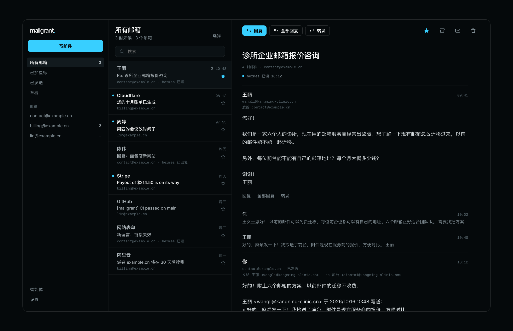

<p align="center"></p>

<h1 align="center">mailgrant</h1>

<p align="center"><b>面向 AI 智能体的自托管邮件网关。</b><br>
一个邮件 MCP 服务器，同时提供 REST API，挡在你的 IMAP/SMTP 邮箱前面：每个 AI 智能体都有自己的令牌、自己的邮箱和自己的权限，你还能用自带的自托管 Webmail 随时查看。</p>

<p align="center">
  <a href="https://github.com/lucasmaffei/mailgrant/actions/workflows/ci.yml"></a>
  
  
  
  <a href="LICENSE"></a>
</p>

<p align="center"><a href="README.md">English</a> · <a href="README.pt-BR.md">Português</a> · <a href="README.es.md">Español</a> · <a href="README.fr.md">Français</a> · <b>简体中文</b></p>

<p align="center"></p>

Claude、Codex、OpenClaw、Hermes，还有你自己写的脚本：
每个要碰邮件的 AI 智能体，最后都会在自己的服务器、自己的配置里存一份所有邮箱的密码。
mailgrant 的做法是在邮箱前面放一个统一的 IMAP/SMTP 网关。
每个邮箱只需注册**一次**，然后由你决定谁能用哪些邮箱、能做哪些操作：

- **AI 智能体**拿到一个 Bearer 令牌，通过 [MCP](https://modelcontextprotocol.io)（Streamable HTTP）或普通 REST 调用。
- **你**可以选用一个 Webmail 应用，手机和电脑都能用，通过通行密钥（passkey）登录，支持推送通知，还能按时间线查看每个智能体做过的所有操作。

无论来自哪一方，每次调用都经过同一套授权和同一份审计日志。

<p align="center"></p>

## 目录

[实际使用](#实际使用) · [功能特性](#功能特性) · [快速开始](#快速开始) · [接入 AI 智能体](#接入-ai-智能体) · [Web 应用](#web-应用) · [配置](#配置) · [REST API](#rest-api) · [安全](#安全) · [常见问题](#常见问题)

## 实际使用

智能体接入后，直接提问就行。
智能体只能看到它的令牌允许的工具和邮箱。

> **你：** 今天 contact@ 收到的邮件里，哪些还没回复？
>
> **智能体**调用 `inbox(mailbox="contact", unseen=true, since="16-Oct-2026")`，再对每封调用 `get_message`：
>
> 有 3 封未读。Mariana（一家诊所，6 个人）想要一份邮箱迁移的报价。
> Pedro 确认了面包店网站的第 2 版。一条表单通知说，
> 10 月活动的链接打开的是错误页面。要我回复 Mariana 吗？

> **你：** 好，在原会话里回复她我们的价格，另外两封标为已读。
>
> **智能体**调用 `send(mailbox="contact", to=["mariana@…"], in_reply_to="<…>", …)`，再调用两次 `mark_seen`。
> 回复会按会话归档到该邮箱的“已发送”文件夹，你的团队（以及 Web 应用）都能看到。

> **一个只读的财务智能体**尝试调用 `send(mailbox="billing", …)`，得到的是
> `403 scope`。它压根就没见过 `send` 这个工具，
> 而这次尝试会在审计日志和应用里显示为**已拒绝**。

常见用法：

| 场景 | 邮箱 | 权限 |
|---|---|---|
| **客户支持。** 智能体在原会话中回复联系地址的来信，回复会进入“已发送”，团队都能看到。 | `contact@` | `read`、`mark`、`send` |
| **财务。** 智能体读取发票和收据来对账。它不能回复，也不能删除任何东西。 | `billing@` | `read` |
| **每日摘要。** 一个定时脚本每天早上汇总所有邮箱里的未读邮件。 | `*` | `read` |
| **个人助理。** 帮你整理自己的收件箱：标记已看过的，把订阅邮件扔进废纸篓，回复例行邮件。 | `you@` | `read`、`mark`、`delete`、`send` |
| **服务多个客户的代理公司。** 每个客户的智能体只能访问该客户的邮箱，即使都在同一台服务器上。 | `client-a@`、`billing@client-a` | `read`、`send` |
| **线索收集。** 销售智能体读取网站表单通知，并用 `sales@` 回复新线索，其他一概看不到。 | `sales@` | `read`、`send` |

更换邮箱密码、切断某个智能体的访问、新增邮箱，
都只需改网关这一处，不用动任何一个智能体。

## 功能特性

- **按智能体授权**：按名称、地址或 `*`（包括以后新增的邮箱）指定邮箱；权限分为 `read`、`mark`、`delete`、`send`。
- **授权之外完全不可见**：智能体无权使用的邮箱，返回的结果和不存在的邮箱一模一样。
- **按权限过滤工具列表**：MCP 的 `tools/list` 只列出该令牌可以调用的工具。
- **统一收件箱**：一次调用即可并行搜索所有已授权的邮箱。
- **安全删除**：默认移到废纸篓；彻底删除需要 `permanent=true`，而且一次只涉及一封邮件。
- **会话内回复**：通过 `in_reply_to` 实现，每封发出的邮件都会在“已发送”文件夹留一份副本。
- **防止冒充**：`from_address` 只能是该邮箱自己的地址和声明过的别名。
- **审计日志**：只记录元数据，从不记录主题或正文。
- **阅读模式**：给智能体用，HTML 邮件以干净的纯文本返回。
- **可选的 Webmail 应用**：可安装的 PWA，支持通行密钥、推送、会话视图、草稿、沙箱中显示的 HTML 邮件，以及智能体的操作记录。支持 English、Português、Español、Français 和简体中文。
- **在应用中管理（可选）**：添加邮箱、创建智能体、修改权限、轮换令牌，实时生效，无需重启。
- **不用 Web 应用时完全无状态**：没有数据库；连接按请求打开、用完即关。
- **密钥来自环境变量**：任何位置都可以用 `${VAR}`，也可以把整个配置放进 `MAILGRANT_CONFIG_B64`。

## 快速开始

你需要 Docker，以及至少一个邮箱的 IMAP/SMTP 信息（最好用应用专用密码）。
五分钟搞定：

```bash
git clone https://github.com/lucasmaffei/mailgrant && cd mailgrant
cp config.example.yaml config.yaml

# 1. 为每个智能体生成一个令牌。令牌交给智能体，哈希值自己留着。
docker run --rm ghcr.io/lucasmaffei/mailgrant:latest mailgrant token --name support-bot

# 2. 编辑 config.yaml：填入你的邮箱、各个智能体及其哈希值，
#    如果要用 Web 应用，再加上 `web:` 一节（见下文）。

# 3. 校验配置。它会列出谁可以访问什么。
docker run --rm -v "$PWD/config.yaml:/etc/mailgrant/config.yaml:ro" \
  ghcr.io/lucasmaffei/mailgrant:latest mailgrant check

# 4. 运行（只发布在回环地址上；对外暴露前请在前面加上 TLS）。
docker compose up -d
curl -s http://127.0.0.1:8000/health
curl -s -H "Authorization: Bearer $TOKEN" http://127.0.0.1:8000/whoami

# 5. 仅 Web 应用需要：生成一次性链接，用来创建你的通行密钥
#    （或者设置 MAILGRANT_SETUP_CODE，在登录页输入它）。
docker compose exec mailgrant mailgrant invite
```

最小可用的 `config.yaml`：

```yaml
agents:
  - name: support-bot
    token_sha256: "9f86d08…"          # 由 `mailgrant token` 输出
    mailboxes: [contact]
    scopes: [read, mark, send]

mailboxes:
  - name: contact
    imap: {host: mail.example.com, username: contact@example.com, password: "${CONTACT_PASSWORD}"}
    smtp: {host: mail.example.com, username: contact@example.com, password: "${CONTACT_PASSWORD}",
           from_address: "Example <contact@example.com>", save_copy_to: Sent}
```

要部署到 PaaS 上？这里有一份分步指南：
**[Coolify](docs/deploy-coolify.md)**（英文）；同样的环境变量在任何 Docker 主机上都适用。
无法访问镜像仓库？`docker compose up -d --build` 会直接从源码构建。

## 接入 AI 智能体

任何支持 Streamable HTTP 和 Bearer 请求头的 MCP 客户端都能用。
完整教程（包括 Cursor 和 Claude Desktop）：**[docs/connect-agents.md](docs/connect-agents.md)**（英文）。

```bash
# Claude Code
claude mcp add --transport http mailgrant https://mail-mcp.example.com/mcp \
  --header "Authorization: Bearer $MAILGRANT_TOKEN"

# Codex
codex mcp add mailgrant --url https://mail-mcp.example.com/mcp \
  --bearer-token-env-var MAILGRANT_TOKEN

# 只能启动 stdio 服务器的客户端（OpenClaw、较旧的客户端）
npx -y mcp-remote@0.1.38 https://mail-mcp.example.com/mcp \
  --transport http-only --header "Authorization: Bearer $MAILGRANT_TOKEN"
```

把 [`.agents/skills/mailgrant/SKILL.md`](.agents/skills/mailgrant/SKILL.md)（英文）这个 skill 交给你的智能体：
它会教智能体先调用 `whoami`、在原会话中回复、删除前先确认。

### 让智能体自己完成配置

先为智能体生成令牌，放进智能体运行环境的 `MAILGRANT_TOKEN` 环境变量，
然后把下面这段提示词粘贴到和它的对话里（换成你自己的 URL）：

```text
把你自己接入我的 mailgrant 邮件网关。

- MCP 端点：https://mail-mcp.example.com/mcp
- 你的令牌在 MAILGRANT_TOKEN 环境变量里。永远不要打印它，
  永远不要以明文写入文件，除了该端点的 Authorization 请求头之外，
  永远不要把它发送到任何地方。

步骤：
1. 判断你运行在哪种智能体框架里，然后添加一个名为 "mailgrant" 的远程 MCP 服务器，
   使用上面的 URL 和请求头
   "Authorization: Bearer <token>"：
   - Claude Code：claude mcp add --scope user --transport http mailgrant <url> --header "Authorization: Bearer $MAILGRANT_TOKEN"
   - Codex：codex mcp add mailgrant --url <url> --bearer-token-env-var MAILGRANT_TOKEN
   - 其他：在你的 MCP 配置里把它注册为带该请求头的 Streamable HTTP 服务器。
     如果你只能启动 stdio 服务器，就用
     npx -y mcp-remote@0.1.38 <url> --transport http-only --header "Authorization:${AUTH_HEADER}"
     并在进程环境变量中设置 AUTH_HEADER="Bearer <token>"。
2. 从
   https://github.com/lucasmaffei/mailgrant/tree/main/.agents/skills/mailgrant
   安装使用说明 skill（Claude Code：~/.claude/skills/mailgrant/SKILL.md）。如果你无法安装
   skill，就读一遍这个文件并遵守其中的规则。
3. 如果你的框架需要，重新加载 MCP 服务器，然后调用 whoami 工具。
4. 告诉我你是哪个智能体、你有哪些权限、能用哪些邮箱，以及每个邮箱有多少封未读邮件
   （调用 inbox 并设置 unseen=true）。不要把任何邮件标为已读，不要删除，也不要发送任何东西。
```

如果智能体回答出了自己的名字、权限和正确的邮箱，就说明已经配置好了。
返回 `401` 表示令牌和配置中的任何哈希值都对不上。

### MCP 工具

| 权限 | 工具 |
|---|---|
| — | `whoami` |
| `read` | `mailboxes`、`inbox`、`list_folders`、`list_messages`、`search`、`get_message` |
| `mark` | `mark_seen` |
| `delete` | `delete_message` |
| `send` | `send` |

读取永远不会改动邮件：文件夹以只读方式打开（`EXAMINE`），
所以“已读”标记会保持人工操作后的状态。

## Web 应用

<p align="center"></p>

一个给邮箱主人用的 Webmail，内置在同一个服务里。
它**默认关闭**；加上 `web:` 一节即可开启：

```yaml
web:
  origin: https://mail.example.com     # 你访问它的地址
  data_dir: /data                       # SQLite，存放通行密钥、推送设备和历史记录
  user: {name: you, mailboxes: ["*"], scopes: [read, mark, delete, send]}
```

用 `mailgrant invite` 创建你的第一个通行密钥（它会生成一个一次性链接，在手机上打开即可），
或者设置 `MAILGRANT_SETUP_CODE`，在登录页输入它。
然后把应用添加到主屏幕，并打开通知。

- **真正的邮件客户端**：所有邮箱合并在一个收件箱，会话视图、全部回复、
  转发、抄送/密送、附件、保存到邮箱“草稿”文件夹的草稿、
  签名、星标、归档、能看出谁发了什么的“已发送”视图、批量
  操作，以及手机上的滑动手势。
- **HTML 邮件按原样呈现**：经过清理，在沙箱框架中显示；远程
  图片要等你允许后才加载，可以按邮件或按发件人设置。
- **智能体时间线**：每个智能体读了什么、发了什么、被拒绝了什么，以及发生的时间；
  智能体发出邮件时还会推送通知。
- **一切都能在应用里管理**（`manage: true`）：邮箱、智能体、权限和
  令牌，实时生效，每次修改都会再次要求验证通行密钥。
- **五种语言**：English、Português、Español、Français 和简体中文，
  跟随设备语言，也可以在“设置”中切换。
- 人和智能体用同一种方式授权，所以只读的手机端只需一行配置。
  删掉这一节，`/app` 就会消失；智能体不受影响。

<p align="center"></p>

完整指南：**[docs/web-app.md](docs/web-app.md)**（英文）（在 iPhone 上安装、
通知、存储了哪些数据、安全模型、如何关闭）。

## 配置

```yaml
agents:
  - name: support-bot
    token_sha256: "9f86d08…"          # 来自 `mailgrant token`；或者 token: "${SUPPORT_TOKEN}"
    mailboxes: [contact]              # 名称、地址或 "*"
    scopes: [read, mark, send]

mailboxes:
  - name: contact
    imap:
      host: mail.example.com          # 默认端口 993，tls 为 ssl
      username: contact@example.com
      password: "${CONTACT_PASSWORD}"
    smtp:
      host: mail.example.com
      port: 465
      tls: ssl
      username: contact@example.com
      password: "${CONTACT_PASSWORD}"
      from_address: "Example <contact@example.com>"
      allowed_from: [sales@example.com]
      save_copy_to: Sent

web:                                  # 可选，见“Web 应用”一节
  origin: https://mail.example.com
  data_dir: /data
  user: {name: owner, mailboxes: ["*"], scopes: [read, mark, delete, send]}
```

[`config.example.yaml`](config.example.yaml) 中记录了所有选项。

### 值得了解的规则

- 授权在启动时检查：智能体的 `mailboxes` 里有拼写错误，服务器会直接拒绝启动，而不是悄悄地什么都不授权。
- 两个智能体使用同一个令牌（或哈希值）会报错。
- `token_sha256` 让配置文件里不含可用的密钥；`token: "${VAR}"` 则把它放在环境变量里。两种都可以。
- `auth.tokens`（来自 docker-mailbox）仍然有效，会给持有它的所有人授予全部权限。`mailgrant check` 会对此发出警告。
- 修改配置文件需要重启。启用 `web.manage: true` 后，邮箱和智能体改为在应用中维护，修改无需重启。

### 邮箱选项

| 键 | 默认值 | 说明 |
|---|---|---|
| `imap.port` / `imap.tls` | `993` / `ssl` | `tls`：`ssl`、`starttls`、`none` |
| `imap.default_folder` | `INBOX` | |
| `imap.trash_folder` | 自动 | 优先使用带 `\Trash` 标记的文件夹，其次是 `Trash`、`Deleted Items`、`Lixeira` |
| `smtp.port` / `smtp.tls` | `587` / `starttls` | |
| `smtp.from_address` | — | 必填。默认的 `From:` |
| `smtp.allowed_from` | `[]` | 调用方可以使用的其他 `From:` 地址 |
| `smtp.save_copy_to` | — | 接收每封已发邮件副本的 IMAP 文件夹（需要配置 `imap`） |

### Web 应用选项

| 键 | 默认值 | 说明 |
|---|---|---|
| `web.enabled` | `true` | 设为 `false` 可保留这一节但关闭应用 |
| `web.origin` | — | 必填。`https://host`（测试时可用 `http://localhost`） |
| `web.data_dir` | `/data` | SQLite；重启后必须保留 |
| `web.user` | `owner`、`*`、全部权限 | 和智能体一样授权 |
| `web.poll_seconds` | `60` | 为推送检查新邮件的间隔 |
| `web.session_days` | `30` | 设备上登录状态的有效期 |
| `web.push_contact` | origin | 提供给推送服务的 `mailto:` 或 `https:` 联系方式 |
| `web.manage` | `false` | 在应用中管理邮箱和智能体；需要 `MAILGRANT_SECRET_KEY`。见 [docs/web-app.md](docs/web-app.md#manage-mailboxes-and-agents-in-the-app-optional)（英文） |
| `web.setup_code` | `MAILGRANT_SETUP_CODE` | 在登录页输入、用于创建第一个通行密钥的代码；创建之后即失效 |

## REST API

除 `/health` 外，所有路由都需要 `Authorization: Bearer <token>`。

| 方法 | 路径 | 权限 | 作用 |
|---|---|---|---|
| `GET` | `/health` | — | 存活检查，始终开放 |
| `GET` | `/whoami` | — | 该令牌对应的智能体、权限和邮箱 |
| `GET` | `/mailboxes` | read | 已授权的邮箱 |
| `GET` | `/inbox` | read | 在所有已授权邮箱中统一搜索 |
| `GET` | `/mailboxes/{name}/folders` | read | IMAP 文件夹 |
| `GET` | `/mailboxes/{name}/messages?folder=&limit=&search=` | read | 按时间倒序的邮件头（原始 IMAP 搜索） |
| `GET` | `/mailboxes/{name}/search?from=&subject=&…` | read | 在单个邮箱中进行结构化搜索 |
| `GET` | `/mailboxes/{name}/messages/{uid}?folder=&reader=` | read | 完整邮件；`reader=true` 时附加 `body_reader` |
| `POST` | `/mailboxes/{name}/messages/{uid}/seen` | mark | 请求体 `{"seen": true\|false}` |
| `DELETE` | `/mailboxes/{name}/messages/{uid}?folder=&permanent=` | delete | 移到废纸篓，或彻底删除 |
| `POST` | `/mailboxes/{name}/send` | send | 发送（见下文） |

`{name}` 也可以是邮箱地址。`/inbox` 和 `/search` 支持 `from`、
`to`、`subject`、`body`、`text`、`since`、`before`（IMAP 日期格式，如
`14-Oct-2026`）、`unseen`、`seen`、`flagged`、`answered`、`larger_than`、
`smaller_than`、`folder` 和 `limit`（≤ 500）；`/inbox` 还支持 `mailbox`
（以 CSV 格式列出名称或地址）。OpenAPI schema 位于 `/openapi.json`（需要令牌）。

```bash
# 该令牌可读的所有邮箱中的未读邮件
curl -s -H "Authorization: Bearer $TOKEN" "http://127.0.0.1:8000/inbox?unseen=true&limit=20"

# 在会话中回复
curl -s -X POST -H "Authorization: Bearer $TOKEN" -H "Content-Type: application/json" \
  http://127.0.0.1:8000/mailboxes/contact/send -d '{
    "to": ["client@example.com"], "subject": "Re: Order 42",
    "body_text": "It ships tomorrow.", "in_reply_to": "<original-message-id@example.com>"
  }'
```

发送请求体：

```json
{
  "to": ["client@example.com"], "cc": [], "bcc": [],
  "subject": "Re: Order 42",
  "body_text": "…", "body_html": null,
  "in_reply_to": "<original-message-id@example.com>",
  "references": null, "reply_to": null, "from_address": null
}
```

错误以 JSON `{"detail": "…"}` 返回：`401` 令牌错误或缺失 · `403` 缺少权限
或 `from_address` 不被允许 · `404` 邮箱不存在**或未授权** ·
`409` 邮箱缺少 IMAP/SMTP 配置 · `502` 邮件服务器拒绝了请求。

## 审计日志

启用 `audit_log: true`（默认）时，每次邮件操作都会通过
`mailgrant.audit` logger 向 stdout 写一行：

```json
{"ts": "2026-10-14T22:01:08+00:00", "agent": "support-bot", "action": "get_message", "outcome": "ok", "mailbox": "contact", "uid": "42"}
{"ts": "2026-10-14T22:01:09+00:00", "agent": "support-bot", "action": "delete_message", "outcome": "denied", "reason": "scope", "mailbox": "contact"}
{"ts": "2026-10-14T22:01:10+00:00", "agent": "support-bot", "action": "send", "outcome": "ok", "mailbox": "contact", "to": ["client@example.com"], "message_id": "<…>"}
```

主题和正文永远不会被记录。

## 安全

- **务必放在 TLS 后面运行。** 令牌和邮件都要经过它。Compose 默认绑定 `127.0.0.1`；只通过 HTTPS 反向代理对外暴露。
- **配置里存有邮箱密码。** 优先使用 `${VAR}` 引用，或者从你所用平台的密钥存储中读取 `MAILGRANT_CONFIG_B64`；永远不要提交填好内容的 `config.yaml`。
- **令牌以恒定时间比较**，而且每次请求都会和所有候选令牌逐一比较。
- **IMAP 命令注入**在边界处就被拦截：文件夹名中的控制字符会被拒绝，文件夹名会加引号，UID 只允许数字。
- **删除绝不会意外地彻底抹掉邮件**：先进废纸篓，`UID EXPUNGE` 只针对一封邮件，不支持 UIDPLUS 的服务器会直接拒绝。
- **Web 应用**只允许通行密钥登录，会话保存在 `HttpOnly`/`SameSite=Strict` cookie 中，每次修改都会检查 `Origin`，提供的 CSP 不从其他源加载任何内容，HTML 邮件经过清理后在沙箱框架中显示，任何脚本都无法运行。详见 [docs/web-app.md](docs/web-app.md#security-model)（英文）。
- **令牌的权限就是它的授权范围。** 只给智能体完成任务所需的最少邮箱和权限；`"*"` 只留给你愿意把所有邮箱都托付给它的智能体。

发现了漏洞？请按照 [SECURITY.md](SECURITY.md)（英文）处理，不要提交公开 issue。

## 常见问题

**支持 Gmail、Outlook、Fastmail、iCloud、Zoho、Mailcow……吗？**
只要支持 IMAP 和 SMTP 就行。Gmail、iCloud 和 Yahoo 请使用应用专用密码；
自托管服务器（Mailcow、Mailu、Dovecot/Postfix）最好为每个网关单独创建一个应用专用密码。

**它是邮件服务器吗？** 不是。它从不接收来自互联网的邮件；
它像邮件客户端一样登录你现有的邮箱。

**我的邮件会经过第三方吗？** 不会。服务由你自己运行；邮件从
你的邮件服务器到你的网关，再到你的智能体。不用 Web 应用时，什么都不存储；
使用 Web 应用时，会存储通行密钥、推送订阅，以及不含主题和正文的操作历史
（启用 `manage: true` 时，还有邮箱和智能体，密码均加密保存）。

**哪些智能体可以用？** 任何支持 Streamable HTTP 的 MCP 客户端（Claude Code、
Codex、Cursor、通过 `mcp-remote` 接入的 Claude Desktop、OpenClaw、Hermes……），
以及任何能发 HTTP 请求的程序。

**智能体能读取所有内容吗？** 只能读取授权范围内的内容。授权之外的邮箱
看起来就像不存在一样，权限之外的工具也不会出现。

## 从源码运行

```bash
uv sync --all-groups
uv run mailgrant check --config config.yaml
uv run mailgrant http --config config.yaml   # 绑定 127.0.0.1:8000
uv run pytest -q
```

README 中的插图和截图由 [`docs/assets/src`](docs/assets/src) 生成。
欢迎贡献，包括为 Web 应用添加新语言：请参阅
[CONTRIBUTING.md](CONTRIBUTING.md)（英文）。

## 致谢

mailgrant 是 Ciprian Mandache（psyb0t）的 [docker-mailbox](https://github.com/psyb0t/docker-mailbox)
的一个分支，后者提供了 IMAP/SMTP 层、统一收件箱、
阅读模式和 MCP 传输。mailgrant 在此基础上增加了按智能体授权、
审计、安全删除、会话内发送和 Web 应用。

## 许可证

MIT，见 [LICENSE](LICENSE)。Docker 镜像中打包的第三方组件
遵循各自的许可证（html2text 为 GPL-3.0；Web 应用的字体为 OFL）；
见 [THIRD_PARTY.md](THIRD_PARTY.md)（英文）。
