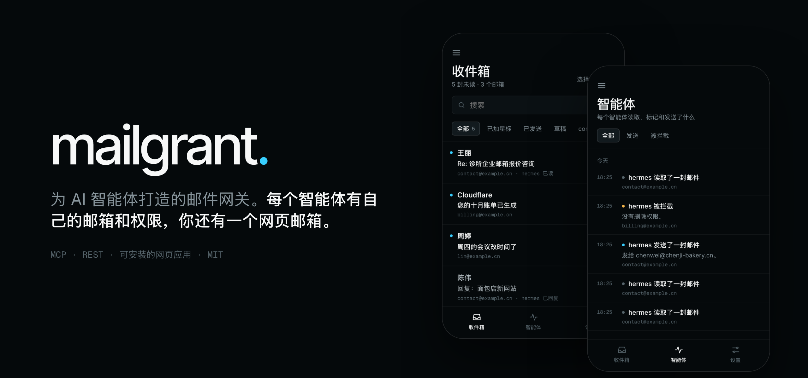
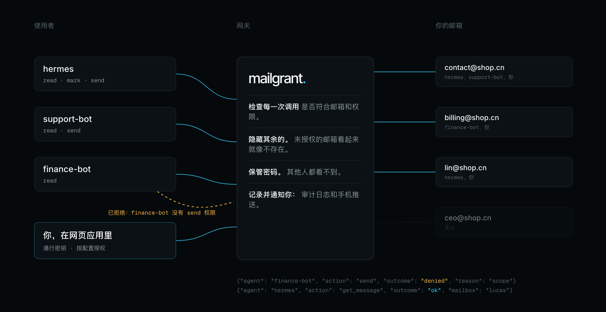
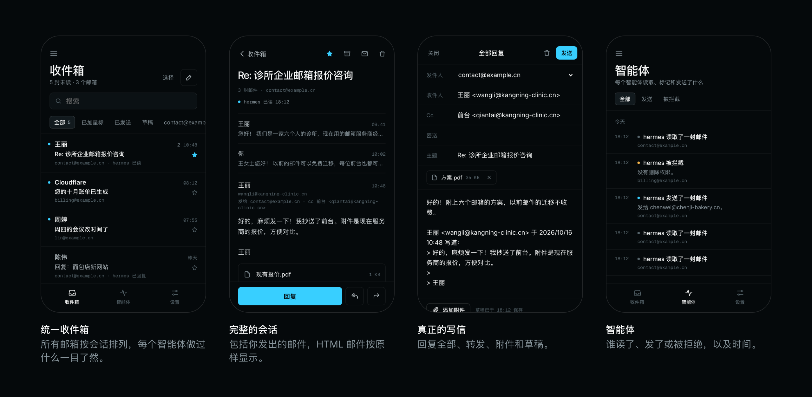

<p align="center"></p>

<h1 align="center">mailgrant</h1>

<p align="center"><b>面向 AI 智能体的自托管邮件网关。</b><br>
每个智能体都有自己的令牌、自己的邮箱和自己的权限。邮箱密码始终留在你手里。</p>

<p align="center">
  <a href="https://github.com/lucasmaffei/mailgrant/actions/workflows/ci.yml"></a>
  
  
  <a href="LICENSE"></a>
</p>

<p align="center"><a href="README.md">English</a> · <a href="README.pt-BR.md">Português</a> · <a href="README.es.md">Español</a> · <a href="README.fr.md">Français</a> · <b>简体中文</b></p>

<p align="center"></p>

没有网关时，每个要碰邮件的智能体（Claude、Codex、OpenClaw、
你自己写的脚本）都存着一份所有邮箱的密码。有了 mailgrant，
每个邮箱只需注册**一次**，每个智能体拿到一个令牌，只能打开你选定的
邮箱、执行你选定的操作。智能体通过
[MCP](https://modelcontextprotocol.io) 或 REST 调用，每次调用都会经过检查并
记入日志。

<p align="center"></p>

**安装：** [1. 获取](#1-获取) · [2. 配置](#2-配置) · [3. 运行](#3-运行) · [4. 接入智能体](#4-接入智能体)<br>
**使用：** [日常使用](#日常使用) · [Web 应用](#web-应用可选) · [文档](#文档)

## 1. 获取

你需要一台装有 Docker 的机器，以及至少一个邮箱的 IMAP/SMTP 信息
（最好用应用专用密码）。

```bash
git clone https://github.com/lucasmaffei/mailgrant && cd mailgrant
cp config.example.yaml config.yaml
```

## 2. 配置

配置里有两个列表：**mailboxes**（网关能访问哪些邮箱）和
**agents**（谁可以用哪个邮箱、可以做什么）。

**为你的第一个智能体创建令牌：**

```bash
docker compose run --rm mailgrant mailgrant token --name support-bot
```

它会输出令牌（交给智能体）和令牌的哈希值（写进配置）。
令牌只显示这一次，不会保存在任何地方。

**把 `config.yaml` 的内容替换成你的邮箱和这个智能体：**

```yaml
mailboxes:
  - name: contact
    imap: {host: mail.example.com, username: contact@example.com, password: "${CONTACT_PASSWORD}"}
    smtp: {host: mail.example.com, username: contact@example.com, password: "${CONTACT_PASSWORD}",
           from_address: "Example <contact@example.com>", save_copy_to: Sent}

agents:
  - name: support-bot
    token_sha256: "9f86d08…"          # 上面输出的哈希值
    mailboxes: [contact]              # 名称、地址，或用 "*" 表示全部
    scopes: [read, mark, send]        # read · mark · delete · send
```

**把密码放进旁边的 `.env` 文件**，这样配置里就不含任何
密钥：

```bash
echo 'CONTACT_PASSWORD=你的邮箱密码' > .env
```

**校验配置。** 它会列出谁可以访问什么，或者准确指出哪里出错：

```bash
docker compose run --rm mailgrant mailgrant check
```

```text
ok: 1 mailbox(es), 1 agent(s)
  support-bot          [mark, read, send]  contact
web app: off (no `web:` section)
```

端口、TLS、别名、废纸篓文件夹以及其他所有选项：
[docs/configuration.md](docs/configuration.md)。

## 3. 运行

```bash
docker compose up -d
curl -s http://127.0.0.1:8000/health      # {"ok":true,"version":"…"}
```

端口只监听 `127.0.0.1`。如果智能体在其他机器上，请用反向代理
（Caddy、Traefik、nginx）或 Coolify 这类平台在前面加上 HTTPS
（[分步指南](docs/deploy-coolify.md)）。

## 4. 接入智能体

智能体需要地址 `https://<your-host>/mcp` 和它自己的令牌：

```bash
# Claude Code
claude mcp add --transport http mailgrant https://mail-mcp.example.com/mcp \
  --header "Authorization: Bearer $MAILGRANT_TOKEN"

# Codex
codex mcp add mailgrant --url https://mail-mcp.example.com/mcp \
  --bearer-token-env-var MAILGRANT_TOKEN
```

然后问它：*“你通过 mailgrant 能用哪些邮箱？”* 它的回答应该
和你授予的权限完全一致。

Cursor、Claude Desktop、OpenClaw、普通 REST，以及一段能让智能体
自己完成配置的提示词：[docs/connect-agents.md](docs/connect-agents.md)。

## 日常使用

编辑 `config.yaml` 或 `.env`，然后用
`docker compose up -d --force-recreate` 让修改生效（单纯的 `restart` 不会重新读取
`.env`）。智能体的令牌保持不变，无需做任何改动。

| 要…… | 这样做 |
|---|---|
| **添加邮箱** | 把它加到 `mailboxes` 下，把密码写进 `.env`。拥有 `"*"` 的智能体立刻就能用；其他智能体需要把它加进自己的 `mailboxes`。 |
| **添加智能体** | 运行 `mailgrant token --name <agent>`，在 `agents` 下添加一项并填入哈希值，再把令牌交给智能体。 |
| **修改智能体的权限** | 编辑它的 `mailboxes` 和 `scopes`。 |
| **切断某个智能体** | 删除它的条目。它的令牌立即失效。 |
| **更换邮箱密码** | 在 `.env` 里修改。智能体从来不知道这个密码。 |
| **查看智能体做了什么** | `docker compose logs mailgrant \| grep mailgrant.audit` 会为每次调用输出一行 JSON，不含主题和正文。 |
| **更新 mailgrant** | `git pull && docker compose up -d --build` |

更喜欢点鼠标？启用 Web 应用并设置 `manage: true` 后，就可以在应用里添加
邮箱和智能体，修改无需重启即可生效。

## Web 应用（可选）

<p align="center"></p>

一个给你自己用的 Webmail，内置在同一个服务里。所有邮箱合并在一个
收件箱里，HTML 邮件安全显示，你可以回复邮件、添加附件。手机上有
推送通知，有每个智能体读了什么、发了什么的时间线，还支持
通行密钥登录。支持 English、Português、Español、Français
和简体中文。

它默认关闭。要开启它，把下面这段加进 `config.yaml`，再用同样的方式让修改生效：

```yaml
web:
  origin: https://mail.example.com      # 你打开它所用的 HTTPS 地址
  user: {name: you, mailboxes: ["*"], scopes: [read, mark, delete, send]}
```

然后运行 `docker compose exec mailgrant mailgrant invite`，在手机上打开
它输出的链接，创建你的通行密钥。

在手机上安装、通知、在应用中管理智能体：
[docs/web-app.md](docs/web-app.md)。

## 文档

以下文档均为英文。

| | |
|---|---|
| [它能做什么](docs/overview.md) | 对话示例、使用场景、功能特性、常见问题 |
| [配置](docs/configuration.md) | 所有选项、规则、环境变量、审计日志 |
| [接入智能体](docs/connect-agents.md) | Claude Code、Codex、Cursor、Claude Desktop、OpenClaw、REST |
| [MCP 工具和 REST API](docs/api.md) | 各权限对应的工具、路由、参数、错误 |
| [Web 应用](docs/web-app.md) | 安装、通知、在应用中管理、存储了哪些数据 |
| [部署到 Coolify](docs/deploy-coolify.md) | 分步指南，包括 HTTPS 和在平台中保存密钥 |
| [安全](docs/security.md) | 网关如何保护邮箱和令牌 |

欢迎贡献，包括为 Web 应用添加新语言：请参阅
[CONTRIBUTING.md](CONTRIBUTING.md)。发现了漏洞？请按照
[SECURITY.md](SECURITY.md) 处理。

## 致谢与许可证

mailgrant 是 Ciprian Mandache（psyb0t）的 [docker-mailbox](https://github.com/psyb0t/docker-mailbox)
的一个分支，后者提供了 IMAP/SMTP 层、统一收件箱、阅读模式和
MCP 传输。mailgrant 在此基础上增加了按智能体授权、审计、
安全删除、会话内发送和 Web 应用。

MIT，见 [LICENSE](LICENSE)。Docker 镜像中打包的第三方组件
遵循各自的许可证；见 [THIRD_PARTY.md](THIRD_PARTY.md)。
