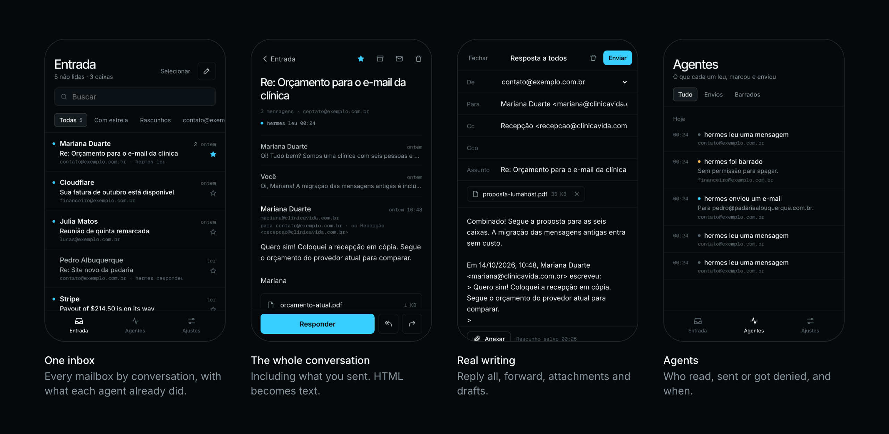
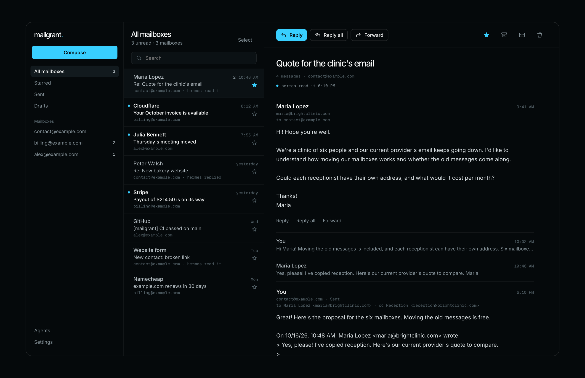

# The web app

[Português](web-app.pt-BR.md)

mailgrant can also serve a small web app for **you**: one inbox across your
mailboxes, what each agent read and sent, and push notifications on your
phone. It installs to the home screen like an app, and you sign in with a
passkey (Face ID, Touch ID, Windows Hello, a security key) — there is no
password.

It is **off unless you turn it on**. Without a `web:` section in the config,
mailgrant stays a stateless MCP/REST gateway: no web routes, no database, no
extra dependencies loaded.

> The interface is in Brazilian Portuguese for now.



## What you get

| Screen | What it does |
|---|---|
| Inbox | Every mailbox you can see, newest first, grouped by conversation, filter by mailbox, search, load older. Each row shows which agent already read or answered it. Also **Com estrela** (starred), **Enviados** (sent) and **Rascunhos** (drafts). |
| Sent | What left every mailbox's Sent folder, newest first, marked with who sent it: you, or the agent ("hermes enviou"). Opening one shows the whole conversation, replies included. |
| Conversation | Every message of the thread, including what you sent (from Sent), oldest first; older ones fold to one line. HTML mail as it was designed (sanitized, in a sandboxed frame, scaled to fit the screen, remote images on request), plain text as text, attachments to download, the agents that touched it. |
| Writing | Reply, reply all, forward (attachments included), Cc and Bcc, attach files from the phone, a signature per mailbox. Replies stay in the thread and are filed in Sent. |
| Drafts | What you write is saved to the mailbox's own Drafts folder a few seconds after you stop typing, so it also shows up in other mail apps. Closing the editor keeps it; opening and closing without writing leaves nothing behind. |
| Agents | The audit trail as a timeline: reads, sends, trash moves, and every refusal — filter by sends or by refusals. |
| Settings | Turn notifications on, pick which mailboxes notify, get a push when an agent sends mail, manage passkeys, see each agent's access. |

Organizing works on one message or many: a star, read/unread, **archive** and
trash. On the phone, swipe a row right to toggle read, left to archive, and
hold it to select several; on a computer, **Selecionar** above the list.

On a phone, the menu button at the top opens the same side menu a computer
shows: views, mailboxes, Agentes and Ajustes. On a computer it becomes three
columns: mailboxes, list, message.



## Turn it on

Add a `web:` section to the config:

```yaml
web:
  origin: https://mail.example.com        # the public URL people open
  data_dir: /data                          # SQLite: passkeys, push devices, history
  user:
    name: lucas
    mailboxes: ["*"]                       # like an agent: names, addresses or "*"
    scopes: [read, mark, delete, send]
  # poll_seconds: 60                       # how often new mail is checked
  # session_days: 30
  # push_contact: mailto:you@example.com   # contact for push services; default: origin
```

- `origin` must be `https://` (passkeys and push only work on secure origins;
  `http://localhost` is accepted for testing). Requests from any other origin
  are refused.
- `user` is granted exactly like an agent. Give yourself fewer scopes if you
  want a read-only phone.
- `data_dir` must be persistent (a Docker volume). It holds no mail.

Restart, then check it:

```bash
mailgrant check
# web app: on at https://mail.example.com/app for lucas [delete, mark, read, send]  all mailboxes; data in /data
```

## Your first passkey

Nobody can sign in until a device has a passkey. There are two ways to create
the first one: a setup code from the environment, or a one-time invite link.

### With a setup code (no terminal needed)

Set a code in the environment, at least 12 characters (on Coolify, a new
environment variable; with Compose, in `.env`):

```bash
MAILGRANT_SETUP_CODE=$(openssl rand -hex 12)
```

Restart, open the app: instead of "Entrar com passkey" it asks for the
**Código de configuração**. Type the code, confirm with Face ID / Touch ID, and
you are in.

The code **only works while there is no passkey**. As soon as the first one is
created the screen goes back to normal and the code is refused, so an old
`.env` can't be used to add a device later. You can delete the variable after
that. `web.setup_code` in the config does the same, and wins over the variable.

### With an invite link

On the server:

```bash
mailgrant invite            # valid 30 minutes, one use (--minutes to change)
# https://mail.example.com/app/#/invite/Lweu52CZ…
```

In Docker: `docker compose exec mailgrant mailgrant invite`. On Coolify, use
the application's **Terminal** tab.

Open the link on the phone or computer that will hold the passkey, name the
device and confirm with Face ID / Touch ID. You are in.

**More devices:** in the app, **Ajustes → Adicionar outro aparelho** creates a
new invite to open on the other device. A signed-in device can also register
another passkey for itself. The last passkey can't be removed, so you can't
lock yourself out by accident; if you lose every device, run `mailgrant invite`
on the server again.

## Install it and turn on notifications

**iPhone / iPad (iOS 16.4 or later)** — notifications only work for the app
added to the Home Screen:

1. Open the URL in Safari, tap **Share → Add to Home Screen**.
2. Open mailgrant from the new icon (not from Safari).
3. **Ajustes → Ativar notificações**, and allow when iOS asks.

**Android / desktop Chrome, Edge, Firefox** — open the URL, sign in,
**Ajustes → Ativar notificações**. Chrome and Edge also offer **Install app**.

Then choose which mailboxes notify. **Testar** sends a test push to every
device that turned notifications on.

### How new mail is detected

Every `poll_seconds` (60 by default) mailgrant asks each mailbox for its
`STATUS` — one cheap command, no download — and pushes only the messages that
arrived since the last check, already unread. The first check after a start
only records where each mailbox is, so a restart never replays old mail. With
several workers, only one process watches (a lock file in `data_dir`).

A push carries the sender's name and the subject, and the unread count for the
app icon badge. It travels encrypted end-to-end (Web Push, RFC 8291) through
the browser vendor's push service (Apple, Google, Mozilla).

## Manage mailboxes and agents in the app (optional)

With `manage: true`, **Ajustes** gets two more lists: your mailboxes and your
agents. Add a mailbox (with **Testar conexão** to check the server, port and
password first), give an agent access to some mailboxes and scopes, take a
scope away, issue a new token, remove an agent. Changes apply at once, on
every worker, without a restart.

```yaml
web:
  origin: https://mail.example.com
  manage: true
```

and set `MAILGRANT_SECRET_KEY` in the environment (any long random string,
e.g. `openssl rand -hex 32`): it encrypts the mailbox passwords in the
database. Without it, mailgrant creates a random key in `data_dir/secret.key`,
which protects a copied database but not a copied `data_dir`.

- **The first start imports** the `mailboxes` and `agents` of the config into
  the database. From then on the database decides and those two sections of
  the file are ignored (the log says so), so you can delete them. Plain
  `token:` values are kept only as their SHA-256.
- **Every change asks for the passkey again** (Face ID / Touch ID), valid for
  five minutes. Reading the lists does not.
- **A new token is shown once**, with a ready-to-paste MCP configuration
  (`url` and `Authorization` header). The database keeps only its hash.
  "Gerar novo token" stops the old one immediately.
- A mailbox listed by name in an agent's permissions can't be removed until
  it is taken out there. Removing a mailbox from mailgrant never touches the
  mail on the server.
- **Baixar config** downloads the whole current config as YAML, passwords
  included: a backup, and the way back to a file.
- The person's own access stays in `web.user`, in the file, so nobody can
  lock themselves out from the app.

To stop managing from the app, download the config, put its `mailboxes` and
`agents` back in the file and set `manage: false` (or remove it). The
database tables stay untouched.

## What is stored, and where

In `data_dir/mailgrant.db` (SQLite):

- passkey public keys and device names — never a private key;
- sessions (a hash of the cookie), invites (a hash), WebAuthn challenges (minutes);
- push subscriptions and your notification choices;
- the push signing key (VAPID), created on first use;
- the audit history for the Agents screen: agent, action, mailbox, UID,
  recipients, outcome — never subjects or bodies — kept 180 days;
- the watcher's position in each mailbox;
- with `manage: true`, the mailboxes (passwords encrypted) and the agents
  (token hashes only).

Mail itself stays on your IMAP servers.

## Security model

- **Passkeys only.** WebAuthn with user verification required. No passwords,
  no recovery email.
- **Invites are one-time and expire.** Stored hashed.
- **Session cookie** is random, `HttpOnly`, `Secure`, `SameSite=Strict`,
  scoped to `/app`. Every change also needs an `X-Mailgrant` header and a
  matching `Origin`.
- **Same rules as agents.** The signed-in person is a principal granted by
  `web.user`; every action goes through the same grant checks and the same
  audit log.
- **HTML mail is shown, locked down.** An HTML body is sanitized on the server
  (no script, forms, frames, event handlers or remote stylesheets) and served
  as its own document with a CSP that has no script source and a CSP sandbox
  without `allow-scripts`; the iframe that shows it is sandboxed the same way.
  Remote images are blocked by that CSP until you tap **Mostrar** (or allow a
  sender's domain, or all senders in Ajustes), since they tell the sender when
  and from where the mail was opened. Inline (`cid:`) images always show.
  Plain-text mail stays text, and attachments always download.
- **Nothing is erased by surprise.** The trash and the archive are moves.
  The one permanent delete is a superseded draft: saving a draft stores a new
  version and erases the previous one, and the server refuses it for any
  message not flagged `\Draft`.
- **Scopes for the new actions.** Star, read/unread and archive need `mark`;
  the trash needs `delete`; drafts need `send`. Forwarding an attachment needs
  `read` on the mailbox it comes from. Attachments are capped at 25 MB per
  message.
- **Strict CSP**: nothing loads from other origins — fonts are bundled, no
  inline scripts or styles, and the only frame allowed is the mail frame from
  the app's own origin.
- Agents' bearer tokens don't open the web app, and the web session doesn't
  open the MCP/REST API.

## Turn it off

Either remove the `web:` section, or keep it and set:

```yaml
web:
  enabled: false
  origin: https://mail.example.com
```

Restart. `/app` disappears, nothing is polled, the database is left untouched
(delete `data_dir` if you want it gone). Agents are not affected either way.

## Troubleshooting

| Symptom | Cause |
|---|---|
| "invite missing, used or expired" / "Convite inválido" | Invites work once, for the minutes given (30 by default). Run `mailgrant invite` again. |
| "Código de configuração errado." | The typed code differs from `MAILGRANT_SETUP_CODE` (it is case-sensitive). |
| No setup code field on the sign-in screen | A passkey already exists, or the variable didn't reach the container: restart after setting it. |
| Passkey prompt fails right away | The page isn't on the configured `origin` (another host, or http). |
| No "Ativar notificações" on iPhone | Open the app from the Home Screen icon, not from Safari. |
| Notifications stop on one device | The push service dropped the subscription (app removed, permission revoked). Turn them on again on that device. |
| New mail never notifies | The mailbox is switched off in Ajustes, or `poll_seconds` is long; check the logs for `watcher:` warnings. |
| Agents screen is empty | Agent history starts when the web app is turned on; earlier activity is only in the logs. |
